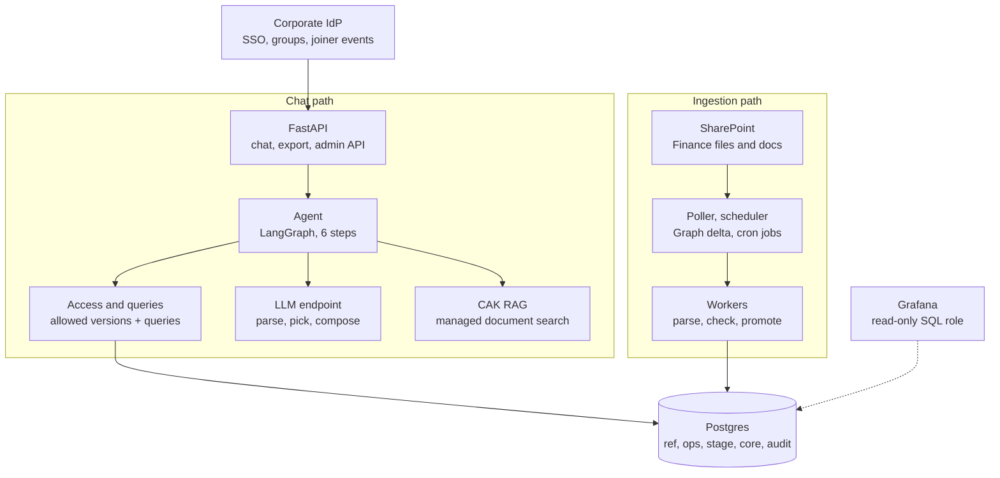
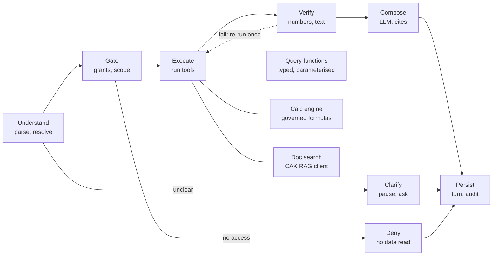

# FIAA simplified design (v2)

Nov 15, 2026 · @bharath preetham

## 1. What changes from the first design

v2 keeps the rule that the LLM understands and explains while code decides access and numbers, and changes nine things to cut build effort. Nothing here removes a PRD requirement; two items (LLM-assisted extraction, documents) move to later releases.

| Area | First design | v2 | Why |
| --- | --- | --- | --- |
| Questions to data | LLM writes SQL over `sem` views, checked by a sqlglot validator | Typed query functions with parameters (lines, metric, versions, lineage) | PRD questions are slot-based; removes the validator, the repair loop and the SQL attack surface |
| Access enforcement | Row level security, `ctl.can_read`, `security_invoker` views, session setting | One resolver returns the allowed version ids for the turn; one data-access module uses them for every query | One place to build and test; row level security can be added later as a backstop |
| Agent graph | 12 nodes | 6 steps: understand, gate, execute, verify, compose, persist | Fewer states and edges to test; clarification still pauses through the checkpoint |
| Template handling | Generic template specification language | One parser class per template, shared helpers; configuration only for mappings, thresholds and status rules | Only four known workbook families |
| Formulas and metrics | Database tables loaded from YAML | YAML in git read at start-up; the git commit is the semantic version | Simpler release; the PRD already requires change control for new metrics |
| Extraction | Deterministic plus an LLM-assisted harness | Deterministic only in releases 1 and 2 | PRD permits LLM-assisted extraction, it does not require it |
| Telemetry | Collector with tail sampling, full span catalogue | The platform's OTel setup and Langfuse, configured and used as provided; Grafana on Postgres for ingestion runs | Nothing to build: set the exporters and add spans around requests, jobs and each agent step |
| Managed RAG | Adapters, per-audience fallbacks, pgvector option | One CAK RAG client; fallbacks only if a gap appears | Defer until the service is tested |
| Table count | About 50 | 28 | Small tables folded into JSON columns |
| Delivery | 20 tasks | 3 releases, structured data first | Value earlier, documents last |

## 2. Architecture v2

One image runs four roles (api, worker, poller, scheduler) and Postgres is the only shared store: it holds the data, the job queue, the chat history and the audit trail. The chat path never touches ingestion tables except through published versions, and workers never call the LLM except in the later LLM-assisted extraction.

&#91;embedded content: architecture v2 · 10 components\]



Only three external services are called from the chat path: the IdP at sign-in, the LLM endpoint, and CAK RAG for documents. Everything else is Postgres and files on the PVC. Traces and metrics go to the platform's OpenTelemetry setup and LLM calls to the platform's Langfuse; both are configured, not built.

## 3. Data model v2

The data model shrinks from about 50 tables to 28 in six schemas, with the same core idea: one fact table, one version table, everything else supports them. The `sem` schema and its views are gone; the query functions read `core` and `ref` directly.

| Schema | Tables | Notes |
| --- | --- | --- |
| `ref` (10) | `entity`, `entity_alias`, `hierarchy_edge`, `fiscal_period`, `group_account`, `gl_mapping`, `fx_rate`, `cf_bs_link`, `associate_section`, `document` | Dated rows with `daterange` and a GiST exclusion where overlap is forbidden; `gl_mapping` holds both GL to account and GL to metric rows, told apart by a `kind` column |
| `ctl` (5) | `app_user`, `access_request`, `grant`, `config`, `source_location` | `config` is one table of `kind`, `key`, JSON value and validity dates for status rules, scope matrix, tolerances, feature flags, source precedence and the template registry; IdP groups are a JSON column on `app_user`; the closure of the hierarchy is a materialised view |
| `core` (3) | `fin_version`, `fact_fin`, `fact_change` | `fin_version` carries statement, scenario, label, scope, period, reporting basis, financial status, publication status, completeness, as-of date, reconciliation status and details, and the status decision fields; `fact_change` records previous and resulting values on Replace and Upsert |
| `stage` (2) | `fact_candidate`, `issue` | Reconciliation results are issue rows with severity, so there is no separate results table |
| `ops` (7) | `source_file`, `job`, `ingest_run`, `conversation`, `turn`, `turn_citation`, `feedback` | `ingest_run` holds the stage events and counters as JSON; `turn` holds the answer, numbers and tool results as JSON; `turn_citation` is separate because citations must outlive other chat content |
| `audit` (1) | `event` | Monthly partitions, append-only, 3-year retention |

Folded away: the metric, formula and bridge tables (now YAML in git), `entity_closure`, `inherit_rule`, `grant_epoch`, `group_member`, `ingest_event`, `recon_result`, `recon_status`, `template_version`, `status_rule`, `recon_override` and `feature_flag` (now rows in `config` or JSON columns).

Constraints that stay in the database, because they protect against application bugs:

- One fact per version, entity, account, period, value basis, adjustment kind and reporting basis.
- One Published version per statement, scenario, label, scope and period.
- No overlapping dates for the same mapping or hierarchy edge.
- Facts of a Published or protected version cannot be updated or deleted; only the promotion function inserts.
- `audit.event` has insert only for its writer role.
- `value_state` Missing or Not applicable has no amount, Reported or Zero has one.

## 4. Access control v2

Access is decided once per turn by one function that returns the list of published version ids the user may read for the question; every data query takes that list as a required argument. No code outside the data-access module reads `core`, and a CI test fails if it does.

| Rule from the PRD | How v2 enforces it |
| --- | --- |
| Entitlement before retrieval and calculation (BR-002) | The gate step calls `allowed_versions(user, slots)` before any query or calculation; an empty result for a requested slot ends the turn with a denial |
| Scenario, scope and domain granted independently (BR-027, 28) | `ctl.grant` rows hold domain, scope node, scenario, status class, classification and function; a missing value means not granted, never everything |
| Approved request for every user, no access by job title (story 1) | A grant can only be created from an approved `ctl.access_request`; the IdP supplies identity and groups, not entitlements |
| Scope includes descendants | The scope node expands through the hierarchy closure (materialised view) for access only; data is never summed through it |
| No substitution, no inference (stories 66, 91, 92) | The denial names the missing dimension and nothing else; a comparison or derived value is refused whole if any input version is not in the allowed list |
| Inheritance between scenarios | `config` rule, off until Finance decides (stories 77 and 92 conflict); when on, it adds Actual to the allowed list of the user's plan scenarios |
| Documents (SF-BR-02) | Classification grants decide the RAG filter or collection, and every returned passage is checked again against the registry before use |
| Export (BR-026, story 77) | Export needs the export function on the grant; classifications marked non-exportable (Board, GCFO) are refused even when the user can view them; every export writes an audit event and a header with period, scenario, version, scope, currency and time |
| Joiners, movers, leavers (BR-025) | An IdP event consumer updates `ctl.app_user` and revokes grants and sessions; a nightly full group sync repairs drift; every change is audited |
| Fresh entitlements | The allowed list is cached per session and revalidated each turn against the latest grant change time, so a revoke takes effect on the next question |

What is deferred: Postgres row level security as a second layer. It is a contained task for release 2 if the security review asks for it, because the allowed-versions predicate is already a single expression that can be reused as the policy.

Tests for this section are the heart of the security sign-off: the NCS but not Group user, Actual without Forecast, a comparison with a denied side, a derived value with a denied input, a non-exportable document, a revoked user mid-conversation.

## 5. Ingestion v2

One file becomes one job and one run. A run is a straight function in plain Python: each step either passes its result on or stops the run with a reason, and nothing is published until every blocking check has passed. Everything is deterministic in releases 1 and 2.

| Step | What happens | Stops the run when |
| --- | --- | --- |
| 1. Detect | Poller reads Graph changes per location, records the file with hash, size, modified time and submitter | Never; an unchanged hash is logged as SKIPPED\_ALREADY\_PROCESSED |
| 2. Fetch | Download to the PVC, confirm the file is complete and readable | File locked or corrupt (retry, then fail) |
| 3. Identify | The parser for the file's family reads workbook structure and metadata block; the template registry in `config` confirms family, version and statement | Unknown template, wrong statement type, statement and scope not in contract scope |
| 4. Extract | The family's parser reads cached values, classifies each row, and writes candidates with sheet, row and column | Missing worksheet, header or mandatory field; Excel errors in required cells |
| 5. Normalise | Map accounts through effective-dated mappings, apply sign, scale and currency basis, derive monthly values from YTD | Unmapped or conflicting accounts keep that dataset in staging |
| 6. Check | Run the checks for the statement: subtotals, controls, accounting equation, cash reconciliations, completeness, duplicates | Any Blocking issue |
| 7. Decide | Resolve the version from metadata, assign financial status from the status rule, apply the upload mode | Target version is protected |
| 8. Promote | One transaction: insert facts, record changes, publication status, supersede the previous Published version, audit | Any database error rolls everything back |
| 9. Report | Write the validation summary and the run result, with a business-readable message for each issue | Not applicable |

Parsers: one class each for P&L, Cash Flow, Balance Sheet and Associate P&L, sharing helpers for reading cached values, finding labelled rows, long-form transformation and lineage. New template versions are a new subclass or a small override, reviewed in a pull request, so a template change is code with tests and not a configuration language.

Rules that carry over unchanged from the first design:

- Status comes from `config` by template family and period type: Draft up to and including 20 days after month-end (30 for quarter-end), then Approved for non-quarter-end (assumption, story 93) or Final for quarter-end. The decision inputs are stored on the version, and status never changes afterwards on its own.
- Upload modes Replace, Upsert and Append, with previous and resulting values in `fact_change`; the same hash is skipped, a changed hash follows the template's mode.
- Final, Locked, Superseded and Archived versions are never changed by an upload.
- Publication status and financial status are separate columns.
- Associate workbooks use section classes LEAF, AGGREGATE, CONSOLIDATED and PRESENTATION from configuration; an unknown section is held, an aggregate never creates facts.

The queue is a Postgres table claimed with `FOR UPDATE SKIP LOCKED`, with a lease time instead of separate heartbeat and reaper processes: a job whose lease expires is simply claimable again, and an advisory lock per version prevents two promotions at once. Telemetry is the run record itself (lifecycle RECEIVED, PROCESSING, SUCCESSFUL or FAILED, stage events, counters, error category, publication outcome), shown in Grafana through SQL.

## 6. Agent v2

The agent is a LangGraph graph with six steps and two exits. LangGraph earns its place through the checkpoint: a clarification question pauses the run, and the user's reply resumes it with the same state. Only Understand and Compose call the LLM.

&#91;embedded content: agent graph v2 · 6 steps, 2 exits\]



Understand extracts the raw phrases, then code resolves entity, period, scenario, version, status, currency and reporting basis, and checks for injection attempts (logging a security event and still answering the real question). Gate calls the access function and stops with Deny when any required slot is outside the user's grants. Execute picks tools by intent.

| Tool | Used for | Notes |
| --- | --- | --- |
| `get_lines` | A statement line or section for entity, period, scenario and version | Returns value state, unit, version and lineage ids |
| `get_metric` | A governed metric (EBITDA, margins, NPAT) | Calc engine runs the YAML formula, never the LLM |
| `compare` | Actual versus plan, version versus version, year on year, movements | Applies like-for-like checks and variance rules, with favourability |
| `bridge` | Reported to Underlying EBIT or NPAT | Only Active bridges; steps shown as a table |
| `composite` | Full-year outlook and RF n+m | Closed periods from Actual, future from the chosen scenario |
| `list_versions`, `get_lineage`, `get_definition` | Which versions exist, where a number came from, how a metric is defined | Plain lookups |
| `search_docs` | Management commentary and policies | Filters by classification and as-of date; returns document name, date, link |

Answer rules, all applied in code or in the fixed Compose prompt:

- Every number is referred to by id and replaced by its formatted value after the text is written, so the model cannot change a figure.
- Every numeric answer opens with statement, period, scenario, version, scope, basis, currency and source dataset; Draft and Working data is labelled.
- Missing, zero and not applicable stay distinct; an incomplete input stops the calculation and is named.
- A document statement cites document name, date or version and a permission-checked link; a driver that no passage supports is stated as not confirmed.
- Where a structured value and a document disagree, both are shown with their sources; structured Finance data is the authority for figures.
- Facts, calculations and management explanations are shown in separate parts.

## 7. Semantic layer v2

The semantic layer is a folder in git that the application reads at start-up. There are no `sem` views and no formula tables; the git commit id is stamped on every turn, so any answer can be reproduced after a change.

```text
semantic/
  metrics/        one YAML per Key Finance Metric
  bridges/        Reported to Underlying EBIT and NPAT
  ontology.yaml   scenarios, statuses, currencies, bases, period phrases, synonyms
  instructions/   answer rules, denial and clarification wording
  tests/          golden questions with expected slots and numbers
```

```yaml
metric: group_ebitda
statement: PL
unit: SGD
favourable: higher
formula:
  op: add
  args:
    - {op: sum_over, metric: opco_ebitda, scope_type: OpCo}
    - {op: sum_over, metric: subgroup_ebitda, scope_type: SubGroup}
    - {ref: share_of_associates_pretax}
  on_missing: null
```

The operand scope types are what prevent double counting: Group EBITDA adds the approved OpCo, sub-group and associate components once, as PL-BR-015 defines, and is never a roll-up of every descendant. Finance reviews every change to `metrics/` and `instructions/` through a pull request; CI checks that every reference exists, units agree and the golden tests pass. GL-to-metric mappings are not in git: they arrive as Finance's SharePoint files into `ref.gl_mapping`.

How each slot is resolved. Code does the work; the LLM only supplies the raw phrase and, for entities, picks between close candidates.

| Slot | Rule | Ask the user when |
| --- | --- | --- |
| Entity | Exact code, then alias, then `pg_trgm` similarity; top candidates go to the LLM only when scores are close | Two candidates remain, or the best score is low; never mapped by meaning alone |
| Period | Governed fiscal calendar (April to March assumed): month, quarter, half-year, full-year, MTD, QTD, YTD, rolling 12 months, prior-year by fiscal period | The phrase fits two readings, for example a bare Q2 |
| Flow or balance | P&L and Cash Flow are summed across periods; Balance Sheet uses the closing snapshot and is never summed | Never; it follows from the line |
| Scenario | Actual, Budget, Rolling Forecast, Operating Forecast, Estimated Close; default Actual, disclosed | More than one is plausible and none is named |
| Version and status | Version selection order below | The order leaves more than one version |
| Currency and basis | Reporting currency of the entity; currency basis (local, actual rate, constant currency); reporting basis (Management or Statutory) defaults from `config`, disclosed | A conversion is asked and the FX flag is off (answer: not available) |
| As-of date | Only for document questions and forecast-as-at questions | The date is unclear |

Version selection order, applied in code (FP-BR-006 to 012):

1. A version named by the user, if it exists and is allowed.
2. An as-of date: the latest approved version whose as-of date is on or before it.
3. Otherwise the latest approved version (Approved, Final or Locked), never a Draft, Working or Submitted one.
4. The latest working version only when the user asks for it and holds the grant, labelled as working data.
5. Incomplete versions are never chosen by default and are never shown as a full-year view.
6. If more than one version remains, ask, or use a configured default and say so.

Every resolved slot, the version id, hierarchy version and source dataset appear in the answer header.

## 8. Release plan

The work is 17 tasks in three releases, down from 20, with structured data end to end first. Every one of the 93 structured stories lands in a release, and the unstructured rules follow in release 3.

| Release | Scope | PRD stories | Exit criteria |
| --- | --- | --- | --- |
| 1. Structured data | P&L, Cash Flow and Balance Sheet ingestion, versions and statuses, access control, chat with governed calculations and comparisons | 1 to 4, 7, 9 to 24, 26 to 30, 32 to 35, 37 to 40, 42, 43, 45 to 55, 57 to 68, 72 to 79, 88, 90 to 93 | Finance signs UAT for structured questions; security tests on access all pass |
| 2. Associates, FX and outlooks | Associate P&L workbooks, composite full-year and RF views, forecast accuracy, underlying bridges, working-capital analysis, FX and constant currency | 25, 31, 36, 41, 44, 56, 80 to 87, 89 | Associate double-count tests pass; FX only if Finance has approved data and method |
| 3. Documents | CAK RAG, document registry, SharePoint and public web ingestion, cited answers combining figures and commentary | 5, 6, 8, 69 to 71 and the unstructured rules SF-BR-01 to 17 | No unentitled passage can be retrieved, cited or inferred; superseded documents are never current |

| # | Task | Release | What it includes |
| --- | --- | --- | --- |
| 1 | Foundation and database | 1 | Repository, one image with four roles, CI/CD, PVC layout, configuration and secrets; wiring to the platform's OTel and Langfuse; the 28 tables, constraints, roles, migrations, immutability and audit partitions |
| 2 | Reference and configuration data | 1 | Loaders for entities, aliases, hierarchy, fiscal calendar, group accounts, GL and GL-to-metric mappings, scope matrix, status rule, tolerances and flags; mapping change workflow with impact and reprocessing decision |
| 3 | Identity and access | 1 | SSO, user and group sync, joiner-mover-leaver events, access requests, grants, `allowed_versions`, denial wording, export rules with the non-exportable classes, access tests |
| 4 | Queue and file intake | 1 | Postgres queue with leases and backoff, Graph delta poller, PVC download, hash idempotency, submitter capture, cut-off tracking |
| 5 | Parsers and normalisation | 1 | P&L, Cash Flow and Balance Sheet parsers, row classification, cached values, wide-to-long with column metadata, mapping, sign, scale, currency and reporting basis, YTD to monthly, unmapped lines held, staging lineage |
| 6 | Checks, versions and promotion | 1 | Check catalogue and tolerances, reconciliation status, completeness, version resolution, status rule, upload modes, change log, protected versions, promotion transaction, validation summary, run lifecycle and Grafana views |
| 7 | Semantic layer and calculation engine | 1 | Ontology, YAML metrics with the PRD formulas, scope-typed operands, period resolver, version selector, comparators, variance and favourability, balance sheet movements, aggregation path, special cases |
| 8 | Agent and API | 1 | Understand with entity resolution and clarification, gate, execute with typed tools, verify, compose with number ids and disclosure header, persist, injection guard, SSE API, export, feedback, audit events |
| 9 | Release 1 test and go-live | 1 | Regression set from the release 1 stories, ingestion test pack, security and load tests, UAT, runbooks, cut-over and hypercare |
| 10 | Associate workbook parser | 2 | Section identification, classes, boundary handling, line mapping, entity reconciliation, double-count tests |
| 11 | Outlooks, bridges and cross-statement analysis | 2 | Composite full-year and RF n+m, forecast accuracy, Reported to Underlying bridges, working-capital analysis with `cf_bs_link` |
| 12 | FX and constant currency | 2 | Rate data, MoM, YoY and QoQ methods, FX exposure, behind the flag until approved |
| 13 | Release 2 hardening and test | 2 | Row level security backstop if required, performance tuning, optional LLM-assisted extraction, regression and UAT for release 2 |
| 14 | CAK RAG and document registry | 3 | Client, capability probe, registry and lifecycle, classification grants, filters or collections, passage re-check |
| 15 | Document and public web ingestion | 3 | SharePoint documents, the four approved public sources, change detection, publication metadata, Public / Singtel Official class, broken-link retry |
| 16 | Document answers | 3 | `search_docs`, as-of retrieval, citation records that outlive the source, conflict and precedence handling, narrative grounding check, separate fact, calculation and explanation parts |
| 17 | Release 3 test and go-live | 3 | Injection and leakage test corpus, regression, UAT, runbooks |

The detailed subtasks are those in the [20-task plan](https://claude.ai/artifact/S2TSUc4onXZtnDbojA3m8f), minus the items cut in section 1 and with the telemetry tasks reduced to configuring the platform setup.

## 9. Deferred items and open decisions

Deferred on purpose, each with the trigger that brings it back:

- **LLM-written SQL:** only if Finance questions appear that the typed tools cannot answer.
- **Row level security:** if the security review requires a second enforcement layer.
- **LLM-assisted extraction:** if a designated Associate or OpCo workbook cannot be read reliably by a deterministic parser.
- **RAG fallbacks** (collection per audience, pgvector): if CAK RAG lacks metadata filters or fast deletion.
- **Generic template language:** if the number of workbook families grows well beyond four.

Telemetry uses the platform's OpenTelemetry and Langfuse, so the remaining work is configuration and instrumentation. Two points need a decision before go-live:

- Langfuse keeps prompts and responses, which here contain confidential figures and passages. Confirm who can read the Langfuse project, set masking or redaction for amounts and document text if needed, and set its retention, so it does not conflict with the PRD's data-minimisation rule for audit (story 78).
- The audit trail stays in Postgres, not in Langfuse or the telemetry backend, because the PRD needs it immutable with a 3-year retention and role-based access.

Open decisions that still apply from the earlier plan:

| Decision | Working assumption |
| --- | --- |
| Non-quarter-end status after 20 days: Approved or Final (stories 67 and 93) | Approved; quarter-end after 30 days is Final |
| Does access to Budget, Forecast or Estimated Close include Actual (stories 77 and 92) | No inheritance |
| Which statuses block an upload (story 19 and FP-BR-002) | FP-BR-002 list; Draft and Working are editable |
| Fiscal calendar | April to March; the calendar file is the source of truth |
| FX data and constant-currency method (stories 36, 44) | Release 2, behind the flag |
| Where Finance receives the validation summary (story 57) | Result file in the SharePoint folder plus an API view |
| Channel for hierarchy, calendar, FX and formula files | Same SharePoint reference folder, once approved |
| Approved output formats (story 65) | Table, narrative and comparison |
| Segment dimension named in stories 66 and 91 | Not modelled |
| Front end | Built separately; this design covers the API |
| CAK RAG capabilities: metadata filters, update delay, deletion | Probed in task 14; collection per audience if filters are missing |

## 10. Traceability: PRD to tasks to LLD

Sections 10 to 24 are the low-level design for the 17 tasks in section 8. Each section names its task numbers and the PRD rules it implements, so a developer can start from a task, and a reviewer can start from a PRD rule. Task numbers are those of section 8; release 2 and 3 sections are marked.

| PRD group | Rules and stories | Tasks | LLD section |
| --- | --- | --- | --- |
| Authentication, authorisation, access lifecycle | BR-001, 002, 025 to 028; stories 1, 2, 66, 77, 91, 92 | 3 | 14 |
| Export | BR-026; story 77 | 3, 8 | 14, 19 |
| Query completeness and clarification | BR-003, 004; stories 33 to 35; SF-BR-16 | 7, 8 | 18, 19 |
| Governed calculations and special cases | BR-005, 017, 018; stories 10, 11, 64, 76, 88, 90 | 7 | 18 |
| Missing, zero, not applicable | BR-006, 007; story 38 | 5, 7 | 16, 18 |
| Overlap and double counting | BR-008, 024; stories 34, 43 | 7 | 18 |
| Source conflict and data sufficiency (structured) | BR-009, 010; story 39 | 8 | 19 |
| Ingestion validation, grain, exceptions | BR-011, 012, 021, 022; stories 12, 45, 51, 57 to 60, 74 | 5, 6 | 16, 17 |
| Lineage and disclosure | BR-013, 023; stories 13, 26 | 5, 6, 8 | 16, 17, 19 |
| Units, reporting basis, currency | BR-014 to 016; stories 35, 36, 44 | 5, 12 | 16, 20 |
| Effective-dated mappings and hierarchy | BR-019, 020; stories 58, 62, 63, 90 | 2 | 13 |
| Templates and status routing | BR-029 to 031; story 73 | 5, 6 | 16, 17 |
| Scenario and version rules, composites | FP-BR-001 to 019; stories 16 to 24, 27 to 31, 41, 61, 67, 93 | 6, 7, 11 | 17, 18, 20 |
| P&L rules | PL-BR-001 to 031 | 5, 6, 7, 11 | 16 to 18, 20 |
| Cash Flow rules | CF-BR-001 to 026; stories 45 to 50 | 5, 6 | 16, 17 |
| Balance Sheet rules | BS-BR-001 to 029; stories 51 to 55 | 5, 6, 7 | 16 to 18 |
| Associate workbooks | Stories 80 to 87 | 10 | 20 |
| Ingestion telemetry and cut-off | Stories 75, 79 | 4, 6 | 15, 17, 22 |
| Audit and feedback | Stories 14, 15, 78 | 8 | 19, 22 |
| Injection guardrails | Story 68; SF-BR-09, 17 | 8, 16 | 19, 21 |
| Rule precedence, output formats | 3.1.6; story 65 | 8 | 19 |
| Documents and public web | SF-BR-01 to 15; stories 5, 6, 8, 69 to 71 | 14 to 16 | 21 |
| Accuracy and AI behaviour clause | Section 3.1.1 note | 9, 13, 17 | 23 |

## 11. Task 1: repository, runtime and deployment

Implements the platform baseline for every other task. PRD link: confidentiality and controlled access (1.2.1), BR-001 (nothing is reachable unauthenticated).

```text
fiaa/
  api/              FastAPI app: routers, schemas, auth dependency, SSE
  agent/            LangGraph graph, steps, tools, prompts, answer composer
  calc/             period resolver, version selector, operators, result objects
  access/           allowed_versions, grants, denial wording, export checks
  data/             the only module that reads core and ref (queries as functions)
  ingest/           poller, queue, parsers/, normalise/, checks/, promote/, report/
  docs/             CAK RAG client, document registry, crawler (release 3)
  telemetry/        OTel and Langfuse setup, span helpers, redaction
  semantic/         metrics/, bridges/, ontology.yaml, instructions/, tests/
  migrations/       Alembic versions
  tests/            unit/, integration/, golden/, fixtures/
  deploy/           manifests per environment
```

One image, four roles chosen by the container command.

| Role | Command | Runs | Scale |
| --- | --- | --- | --- |
| `api` | `uvicorn fiaa.api.main:app` | Chat, export, admin and health endpoints | 2 or more replicas, stateless |
| `worker` | `python -m fiaa.ingest.worker` | Claims jobs, runs ingestion and document jobs | 1 to 3 replicas; concurrency per job kind from settings |
| `poller` | `python -m fiaa.ingest.poller` | Graph delta per source location, enqueues jobs | 1 replica (leader lock in Postgres) |
| `scheduler` | `python -m fiaa.ingest.scheduler` | Cron jobs: retention, drift checks, web crawl, reference refresh | 1 replica (leader lock) |

PVC layout (mounted at `/data`, read-write for worker and poller, no mount for api):

| Path | Content | Cleanup |
| --- | --- | --- |
| `/data/inbox/{file_id}/` | Downloaded workbook while processing | Moved to archive on completion |
| `/data/archive/{yyyy}/{mm}/{sha256}.xlsx` | Every ingested file, kept for audit | Retained per policy; never deleted by code except by retention job |
| `/data/quarantine/` | Corrupt or unsupported files | Reviewed manually |
| `/data/tmp/` | Scratch | Emptied nightly |

Settings come from environment variables through one typed settings class (`pydantic-settings`); secrets are mounted from the platform secret store and never written to the PVC, logs or Langfuse.

| Group | Settings |
| --- | --- |
| Database | `DB_DSN_APP`, `DB_DSN_WRITER`, `DB_DSN_AUDIT`, `DB_DSN_MIGRATOR`, pool sizes, statement timeout (api 15 s, worker 300 s) |
| Identity | `OIDC_ISSUER`, `OIDC_AUDIENCE`, `OIDC_JWKS_URL`, claim names for subject, groups, name |
| SharePoint | `GRAPH_TENANT`, `GRAPH_CLIENT_ID`, `GRAPH_SECRET_REF`, poll interval |
| LLM and RAG | `LLM_ENDPOINT`, `LLM_MODEL`, `RAG_ENDPOINT`, `RAG_API_KEY_REF` |
| Telemetry | `OTEL_EXPORTER_OTLP_ENDPOINT`, `OTEL_SERVICE_NAME`, `LANGFUSE_HOST`, `LANGFUSE_PUBLIC_KEY_REF`, `LANGFUSE_SECRET_KEY_REF`, `LANGFUSE_MASK=on` |
| Behaviour | `FEATURE_FLAGS` default source is the `ctl.config` table, not the environment |

Database roles (one login each, least privilege):

| Role | Can | Cannot |
| --- | --- | --- |
| `app_reader` (api) | Select on `ref`, `core`, `ctl`, `ops.turn*`; insert and update on `ops.conversation`, `ops.turn`, `ops.turn_citation`, `ops.feedback` | Write `core`, `stage`, `audit` |
| `app_writer` (worker) | Insert and update on `stage`, `ops`; execute `core.promote_run()` | Update or delete `core.fact_fin` directly |
| `audit_writer` | Insert on `audit.event` | Update, delete, select |
| `po_reader` | Select on `audit.event` and aggregate views | Select on `ops.turn.content` |
| `grafana_ro` | Select on run, job and aggregate views | Select on facts or chat content |
| `migrator` | DDL | Used only by the migration job |

CI gates, all required on every pull request:

1. Lint and type check (`ruff`, `mypy` strict on `access/`, `calc/`, `data/`).
2. Unit tests with coverage floor on `access/` and `calc/` of 90 percent.
3. Migration test: apply all migrations to an empty database, then run the constraint tests of section 12.
4. Boundary test: fails if any module other than `data/` imports the database driver for `core` or `ref` queries.
5. Golden tests for the semantic layer and the release's regression subset (section 23).
6. Image build, vulnerability scan, dependency audit.

Environments are dev, test, UAT and production, each with its own database, secrets and SharePoint folders; promotion is by image tag, and database migrations run first as a job, using expand then contract so the previous image still works.

## 12. Tasks 1 and 2: database DDL

The 28 tables of section 3 as SQL. Migrations apply this in order with Alembic. `grant` is a reserved word, so the access table is `ctl.grant_row` wherever section 3 says `grant`. Implements the grain, lineage, mapping and version rules BR-012, 013, 014, 019, 020; FP-BR-002; PL-BR-001 to 004; stories 58, 61, 62, 63, 67, 93.

```sql
create extension if not exists btree_gist;
create extension if not exists pg_trgm;
create schema ref; create schema ctl; create schema core;
create schema stage; create schema ops; create schema audit;

-- ref: reference data (task 2 loads it) ------------------------------------
create table ref.entity (
  entity_id    int generated always as identity primary key,
  entity_code  text not null unique,
  entity_name  text not null,
  entity_type  text not null check (entity_type in ('Group','SubGroup','OpCo','Entity','Associate')),
  currency     char(3) not null,
  active       boolean not null default true);

create table ref.entity_alias (
  entity_id  int  not null references ref.entity,
  alias_norm text not null,            -- lower-case, punctuation stripped
  alias_raw  text not null,
  primary key (entity_id, alias_norm));
create index entity_alias_trgm on ref.entity_alias using gin (alias_norm gin_trgm_ops);

create table ref.hierarchy_edge (       -- one parent per child per hierarchy per date
  edge_id           int generated always as identity primary key,
  hierarchy_name    text not null default 'Group',   -- e.g. Group, GroupExOptus
  hierarchy_version text not null,
  parent_id         int not null references ref.entity,
  child_id          int not null references ref.entity,
  valid_during      daterange not null,
  source_file_id    bigint,
  exclude using gist (hierarchy_name with =, child_id with =, valid_during with &&));

create table ref.fiscal_period (
  period_id       int primary key,          -- yyyymm of the month end, e.g. 202504
  fiscal_year     int not null,             -- FY26 = April 2025 to March 2026
  period_no       int not null check (period_no between 1 and 12),
  period_start    date not null,
  month_end       date not null,
  quarter_no      int not null check (quarter_no between 1 and 4),
  half_no         int not null check (half_no in (1, 2)),
  is_quarter_end  boolean not null,
  unique (fiscal_year, period_no));

create table ref.group_account (
  account_id    int generated always as identity primary key,
  statement     text not null check (statement in ('PL','CF','BS')),
  account_code  text not null,
  account_name  text not null,
  line_class    text not null check (line_class in ('Detail','SourceSubtotal','SourceTotal',
                  'ConsolidationAdj','KFM','Memo','SectionHeader','OpeningBalance',
                  'ClosingBalance','ReconAdj')),
  nature        text,                       -- Revenue, Expense, Asset, Liability, Equity, Inflow, Outflow
  normal_balance text check (normal_balance in ('Dr','Cr')),
  parent_id     int references ref.group_account,
  path          text not null,              -- the single approved aggregation path
  attrs         jsonb not null default '{}',-- activity, current/non-current, operating flag, favourability override
  valid_during  daterange not null,
  exclude using gist (statement with =, account_code with =, valid_during with &&));

create table ref.gl_mapping (
  mapping_id        bigint generated always as identity primary key,
  kind              text not null check (kind in ('Account','Metric')),
  entity_id         int references ref.entity,         -- null means all entities
  source_account    text not null,
  target_account_id int references ref.group_account,
  target_metric     text,
  sign              smallint not null default 1 check (sign in (-1, 1)),
  valid_during      daterange not null,
  status            text not null check (status in ('Active','Inactive','Proposed')),
  source_file_id    bigint,
  check ((kind = 'Account' and target_account_id is not null)
      or (kind = 'Metric'  and target_metric is not null)),
  exclude using gist ((coalesce(entity_id, 0)) with =, kind with =, source_account with =,
                      (coalesce(target_metric, '')) with =, valid_during with &&)
          where (status = 'Active'));

create table ref.fx_rate (
  fx_version text not null,
  rate_type  text not null check (rate_type in ('Actual','Constant','Closing','Average')),
  from_ccy   char(3) not null,
  to_ccy     char(3) not null,
  period_id  int not null references ref.fiscal_period,
  rate       numeric(18,8) not null,
  source_file_id bigint,
  primary key (fx_version, rate_type, from_ccy, to_ccy, period_id));

create table ref.cf_bs_link (
  link_id       int generated always as identity primary key,
  cf_account_id int not null references ref.group_account,
  bs_account_id int not null references ref.group_account,
  link_kind     text not null check (link_kind in ('WorkingCapital','Cash','Debt','Other')),
  sign          smallint not null default 1 check (sign in (-1, 1)),
  valid_during  daterange not null);

create table ref.associate_section (
  heading_norm         text primary key,
  section_class        text not null check (section_class in ('LEAF','AGGREGATE','CONSOLIDATED','PRESENTATION')),
  associate_entity_id  int references ref.entity,
  check (section_class <> 'LEAF' or associate_entity_id is not null));

create table ref.document (           -- release 3
  document_id     uuid primary key default gen_random_uuid(),
  title           text not null,
  doc_type        text not null,
  classification  text not null,
  status          text not null check (status in ('Draft','Approved','Superseded','Deactivated','Deleted')),
  version_label   text,
  published_on    date,
  effective_during daterange,
  source_kind     text not null check (source_kind in ('SharePoint','PublicWeb')),
  source_url      text,
  content_sha256  text,
  rag_ref         text,
  owner           text,
  supersedes      uuid references ref.document,
  metadata        jsonb not null default '{}',
  indexed_at      timestamptz);

-- ctl: access and configuration (tasks 2 and 3) ---------------------------------
create table ctl.app_user (
  user_id      bigint generated always as identity primary key,
  idp_subject  text not null unique,
  display_name text, email text,
  idp_groups   text[] not null default '{}',
  active       boolean not null default true,
  synced_at    timestamptz,
  changed_at   timestamptz not null default now());

create table ctl.access_request (
  request_id    bigint generated always as identity primary key,
  user_id       bigint not null references ctl.app_user,
  status        text not null check (status in ('Requested','Approved','Rejected','Revoked')),
  justification text, ticket_ref text,
  requested_at  timestamptz not null default now(),
  decided_by    text, decided_at timestamptz);

create table ctl.grant_row (
  grant_id        bigint generated always as identity primary key,
  request_id      bigint not null references ctl.access_request,
  principal_kind  text not null check (principal_kind in ('user','group')),
  principal       text not null,                 -- user_id as text, or IdP group name
  domain          text not null check (domain in ('PL','CF','BS','DOCS')),
  scope_entity_id int references ref.entity,     -- node; descendants expand at read time
  scenario        text,
  status_class    text check (status_class in ('Approved','Working')),
  classification  text,                          -- documents only
  function        text not null check (function in ('view','export','audit_view','admin')),
  active          boolean not null default true,
  granted_at      timestamptz not null default now(),
  revoked_at      timestamptz,
  check ((domain = 'DOCS' and classification is not null)
      or (domain <> 'DOCS' and scope_entity_id is not null
          and scenario is not null and status_class is not null)));

create table ctl.config (
  config_id    bigint generated always as identity primary key,
  kind         text not null,   -- status_rule, scope_matrix, tolerance, feature_flag, source_precedence,
                                -- classification, template, output_format, default
  key          text not null,
  value        jsonb not null,
  valid_during daterange not null default daterange(null, null),
  changed_by   text, changed_at timestamptz not null default now(),
  exclude using gist (kind with =, key with =, valid_during with &&));

create table ctl.source_location (
  location_id     int generated always as identity primary key,
  name            text not null,
  kind            text not null check (kind in ('Statements','Forecasts','Reference','Documents')),
  graph_drive_id  text not null,
  graph_folder_id text not null,
  delta_link      text,
  template_family text,
  cutoff_rule     jsonb,
  active          boolean not null default true);
```

```sql
-- core: published financial data (written only by core.promote_run) ----------------
create table core.fin_version (
  version_id        bigint generated always as identity primary key,
  statement         text not null check (statement in ('PL','CF','BS')),
  scenario          text not null check (scenario in ('Actual','Budget','RollingForecast',
                      'OperatingForecast','EstimatedClose')),
  label             text not null,                 -- e.g. 'RF 3+9', 'Budget FY27', 'Actual'
  scope_entity_id   int  not null references ref.entity,
  period_id         int  not null references ref.fiscal_period,   -- reporting period / cycle month
  reporting_basis   text not null default 'Management',
  currency_basis    text not null check (currency_basis in ('Local','ActualRate','ConstantCurrency')),
  fin_status        text not null check (fin_status in ('Draft','Working','Submitted','Approved',
                      'Final','Locked','Archived')),
  publish_status    text not null check (publish_status in ('Staged','Published','Failed','Superseded')),
  completeness      text not null default 'Complete'
                      check (completeness in ('Complete','IncompletePeriods','IncompleteLines')),
  completeness_detail jsonb,
  recon_status      text not null default 'NotTested'
                      check (recon_status in ('NotTested','Reconciled','ReconciledRounding',
                      'Exception','ApprovedOverride')),
  recon_detail      jsonb,
  as_of             date not null,
  hierarchy_version text,
  fx_version        text,
  status_basis      jsonb,   -- month_end, is_quarter_end, ingested_at, threshold_days, rule_id
  template_family   text, template_version text,
  source_run_id     bigint,
  supersedes        bigint references core.fin_version,
  created_at        timestamptz not null default now());
create unique index one_published_version on core.fin_version
  (statement, scenario, label, scope_entity_id, period_id, reporting_basis, currency_basis)
  where publish_status = 'Published';

create table core.fact_fin (
  fact_id        bigint generated always as identity primary key,
  version_id     bigint not null references core.fin_version,
  entity_id      int    not null references ref.entity,
  account_id     int    not null references ref.group_account,
  period_id      int    not null references ref.fiscal_period,
  value_basis    text   not null check (value_basis in ('Monthly','YTD','Closing','Opening','FullYear')),
  adj_kind       text   not null default 'Base',
  value_state    text   not null check (value_state in ('Reported','Zero','Missing','NotApplicable')),
  amount         numeric(24,4),               -- in base units, after unit scale
  source_amount  numeric(24,4), source_sign smallint,
  currency       char(3) not null,
  unit_scale     int not null default 1,      -- scale found in the source (1, 1000, 1000000)
  source_file_id bigint not null,
  sheet text, row_no int, col_no int,
  mapping_id     bigint, run_id bigint not null,
  check ((value_state in ('Reported','Zero') and amount is not null)
      or (value_state in ('Missing','NotApplicable') and amount is null)),
  unique (version_id, entity_id, account_id, period_id, value_basis, adj_kind));
create index fact_by_lookup on core.fact_fin (version_id, entity_id, account_id, period_id);

create table core.fact_change (        -- previous and resulting values on Replace and Upsert
  change_id   bigint generated always as identity primary key,
  run_id      bigint not null, version_id bigint not null,
  fact_key    jsonb  not null,
  old_amount  numeric(24,4), new_amount numeric(24,4),
  old_state   text, new_state text, mode text not null,
  changed_at  timestamptz not null default now());

-- stage: per-run working tables (task 5) --------------------------------------------
create table stage.fact_candidate (
  run_id bigint not null, cand_no bigint generated always as identity,
  sheet text, row_no int, col_no int,
  source_label text, source_account text, associate_heading text,
  entity_code text, period_id int, scenario text, label text,
  value_basis text, adj_kind text default 'Base',
  raw_value text, amount numeric(24,4), value_state text, currency char(3), unit_scale int,
  line_class text, account_id int, mapping_id bigint,
  disposition text not null default 'Pending'
    check (disposition in ('Pending','Accepted','Held','Rejected','Skipped')),
  extraction_method text not null default 'deterministic',
  primary key (run_id, cand_no));

create table stage.issue (
  issue_id bigint generated always as identity primary key,
  run_id   bigint not null,
  severity text not null check (severity in ('Blocking','Warning','Info')),
  category text not null check (category in ('FINANCE_DATA_ERROR','SOURCE_FILE_ERROR','MAPPING_ERROR',
             'RECONCILIATION_ERROR','DUPLICATE_DATA_ERROR','TECHNICAL_ERROR',
             'SHAREPOINT_CONNECTIVITY_ERROR','DATABASE_ERROR','SECURITY_ACCESS_ERROR',
             'CONFIGURATION_ERROR')),
  code     text not null,                -- e.g. PL_REV_RECON, UNMAPPED_ACCOUNT
  message  text not null,                -- business-readable
  detail   jsonb,                        -- expected, actual, variance, tolerance for recon checks
  sheet text, row_no int, col_no int, account_code text, entity_code text, period_id int);
create index issue_by_run on stage.issue (run_id, severity);

-- ops: queue, runs, chat (tasks 4, 6, 8) ----------------------------------------------
create table ops.source_file (
  file_id       bigint generated always as identity primary key,
  location_id   int not null references ctl.source_location,
  graph_item_id text not null, name text not null,
  sha256        text not null, size_bytes bigint,
  modified_at   timestamptz, submitted_by text,
  pvc_path      text, first_seen_at timestamptz not null default now(),
  unique (location_id, graph_item_id, sha256));

create table ops.job (
  job_id       bigint generated always as identity primary key,
  kind         text not null,           -- ingest_file, refresh_reference, crawl_source, index_document
  payload      jsonb not null,
  dedupe_key   text unique,
  state        text not null default 'Queued' check (state in ('Queued','Running','Done','Failed','Dead')),
  attempts     int not null default 0, max_attempts int not null default 5,
  run_after    timestamptz not null default now(),
  lease_until  timestamptz, locked_by text, last_error text,
  trace_context jsonb,
  created_at   timestamptz not null default now(), updated_at timestamptz not null default now());
create index job_ready on ops.job (run_after) where state in ('Queued','Running');

create table ops.ingest_run (
  run_id        bigint generated always as identity primary key,
  file_id       bigint references ops.source_file,
  job_id        bigint references ops.job,
  parent_run_id bigint references ops.ingest_run,
  lifecycle     text not null check (lifecycle in ('RECEIVED','PROCESSING','SUCCESSFUL','FAILED',
                  'SKIPPED_ALREADY_PROCESSED')),
  step          text,                   -- detect, fetch, identify, extract, normalise, check, decide, promote, report
  template_family text, template_version text, extraction_method text,
  statement text, entity_code text, period_id int, scenario text, label text,
  version_id    bigint references core.fin_version,
  published     boolean not null default false,
  publication_outcome text,             -- AVAILABLE, NOT_AVAILABLE_BLOCKING_FAILURE, NOT_AVAILABLE_FAILED
  counts        jsonb not null default '{}',   -- extracted, accepted, rejected, held, unmapped, duplicates, recon_exceptions
  events        jsonb not null default '[]',   -- [{stage, outcome, at, ms, category}]
  error_category text, error_summary text,
  started_at timestamptz, finished_at timestamptz, trace_id text);

create table ops.conversation (
  conversation_id uuid primary key default gen_random_uuid(),
  user_id bigint not null references ctl.app_user,
  title text, created_at timestamptz not null default now(),
  last_turn_at timestamptz, archived boolean not null default false,
  context jsonb not null default '{}');   -- resolved slots carried into follow-ups

create table ops.turn (
  turn_id uuid primary key default gen_random_uuid(),
  conversation_id uuid not null references ops.conversation,
  seq int not null, question text not null,
  status text not null check (status in ('Answered','Clarifying','Denied','NoData','Failed')),
  intent text, slots jsonb, allowed_hash text,
  semantic_version text,                 -- git commit of semantic/
  content jsonb,                         -- answer, numbers, tool results (purged early)
  trace_id text, latency_ms int,
  created_at timestamptz not null default now(),
  unique (conversation_id, seq));

create table ops.turn_citation (          -- kept for the audit retention period
  citation_id bigint generated always as identity primary key,
  turn_id uuid not null, kind text not null check (kind in ('fact','document')),
  ref jsonb not null,                    -- fact: version, fact_ids, source file; document: id, title, version, url, class
  created_at timestamptz not null default now());

create table ops.feedback (
  turn_id uuid not null, user_id bigint not null,
  rating smallint not null check (rating in (-1, 1)), reason text,
  created_at timestamptz not null default now(),
  primary key (turn_id, user_id));

-- audit ------------------------------------------------------------------------------
create table audit.event (
  event_id bigint generated always as identity,
  occurred_at timestamptz not null default now(),
  actor text, action text not null, object_type text, object_id text,
  outcome text, detail jsonb not null default '{}', trace_id text,
  primary key (occurred_at, event_id)) partition by range (occurred_at);
```

Triggers and functions that enforce the integrity rules (task 2 tests each):

```sql
-- facts change only inside core.promote_run, and only while the version is editable
create function core.guard_fact() returns trigger language plpgsql as $$
declare s text;
begin
  if current_setting('fiaa.promoting', true) is distinct from 'on' then
    raise exception 'facts change only through core.promote_run';
  end if;
  select fin_status into s from core.fin_version
   where version_id = coalesce(new.version_id, old.version_id);
  if tg_op <> 'INSERT' and s not in ('Draft','Working') then
    raise exception 'version is protected (%)', s;
  end if;
  return coalesce(new, old);
end $$;
create trigger fact_guard before insert or update or delete on core.fact_fin
  for each row execute function core.guard_fact();

-- audit is append-only
create function audit.no_change() returns trigger language plpgsql as $$
begin raise exception 'audit.event is append-only'; end $$;
create trigger audit_append_only before update or delete on audit.event
  for each row execute function audit.no_change();

-- monthly partitions are created by the scheduler job 'audit_partitions' (next 3 months)
-- and detached after 36 months by the retention job
```

A tested migration also creates the two partial indexes `job_ready` and `one_published_version`, and a materialised view `ref.entity_closure(hierarchy_name, ancestor_id, descendant_id, valid_during)` refreshed after each hierarchy load (task 3 uses it for access scope expansion only).

## 13. Task 2: configuration data and reference refresh

Implements BR-019, BR-020, BR-029 to 031, FP-BR-001, stories 62, 63 and 90, and the scope matrix of section 1.5.1. Finance owns reference content; the system only validates, effective-dates and applies it (story 62 AC8: no in-app editing).

`ctl.config` holds every small rule table. One function, `cfg(kind, key, on_date)`, reads a row valid on a date; code never reads a rule from an environment variable or a constant.

| Kind | Key | Value shape | Used by |
| --- | --- | --- | --- |
| `status_rule` | `{template_family}:{period_type}`, for example `LivePL:NonQuarterEnd` | `{"draft_through_days": 20, "after": "Approved"}`; `LivePL:QuarterEnd` is `{"draft_through_days": 30, "after": "Final"}`; `Historical:*` is `{"fixed": "Final"}` (assumption) | Promotion, section 17 |
| `scope_matrix` | statement | `{"levels": ["Group","SubGroup","OpCo","Entity"]}` for PL; `["Group","SubGroup"]` for CF and BS | Template identification, gate |
| `tolerance` | `{currency}:{unit_scale}` | `{"abs": 1.0, "rounding_abs": 1.0, "pct": null}` | Checks |
| `feature_flag` | name | `{"enabled": false}`; names `fx_constant_currency`, `fx_exposure`, `bridges`, `composite_views`, `docs_enabled` | Calc, agent |
| `template` | `{family}:{version}` | `{"statement":"PL","parser":"PLLive","upload_mode":"Replace","extraction_method":"deterministic","scopes":["Group","SubGroup"],"status_rule":"LivePL"}` with validity dates for migration (AC14) | Parsers |
| `source_precedence` | measure type | `{"authority":"structured","over":["document","public"]}` | Verify, compose |
| `classification` | name (Public, Internal, Confidential, Board, GCFO) | `{"exportable": false, "rag_collection": "board"}` | Access, RAG |
| `default` | `scenario`, `reporting_basis`, `currency_basis`, `period` | Approved default shown to the user | Understand |
| `output_format` | name | `{"enabled": true}` for table, narrative, comparison | Compose |

Reference refresh (job kind `refresh_reference`) is one transaction per file, so a file applies completely or not at all:

1. **Detect.** The poller sees a file in a `Reference` location; the file name selects the loader (`gl_mapping`, `metric_mapping`, `hierarchy`, `calendar`, `fx`). Only the GL and metric mapping loaders are in contract scope today (story 62 AC8); the others stay behind the open decision in section 9.
2. **Validate fields.** Required columns, types, dates (`effective_from` before `effective_to`), allowed status, target account or metric exists, statement matches the target, sign is 1 or -1 (AC2).
3. **Detect overlap and conflict.** Each row is inserted inside a savepoint; an exclusion violation means two active mappings would resolve the same source account, entity and period (AC3, AC4). The row is written to the result as a MAPPING\_ERROR and the whole file stops unless the operator chooses to apply the rest.
4. **Effective-date, never overwrite.** For a changed mapping the current row's `valid_during` is closed at the new `effective_from` and a new row is inserted (BR-019):

```sql
update ref.gl_mapping
   set valid_during = daterange(lower(valid_during), :effective_from)
 where mapping_id = :old_id and status = 'Active' and upper(valid_during) is null;
insert into ref.gl_mapping (kind, entity_id, source_account, target_account_id, target_metric,
                            sign, valid_during, status, source_file_id)
values (:kind, :entity_id, :source, :target, :metric, :sign,
        daterange(:effective_from, :effective_to), 'Active', :file_id);
```

5. **Impact analysis.** Select the distinct versions that used a mapping whose period overlaps the change and whose `fin_status` is Draft or Working (`core.fact_fin.mapping_id` joins to the closed row). Versions in Approved, Final or Locked are never touched (AC5, BR-019). For each editable version, list the Opco, sub-group and Group metrics that depend on the affected accounts (from the metric YAML) and store the list as the reprocessing decision (AC6).
6. **Audit.** One `audit.event` per changed mapping with action `reference.mapping_changed` and detail `{previous, proposed, effective_from, effective_to, proposer: file submitter, status}` (AC7), plus one `reference.reprocess_decision` event carrying the impact list.
7. **Reprocess only by command.** An operator command `reprocess --file {id} --reason {text}` enqueues the original file again as a child run; it applies only to editable versions and the old and new values go to `core.fact_change`.

Hierarchy versioning (story 63): `ref.hierarchy_edge` is loaded with `hierarchy_version` and `valid_during`; `ref.entity_closure` is refreshed afterwards. A query resolves edges on the period end date, unless the user selects a named hierarchy version; the hierarchy version used is stored on `core.fin_version` and shown in the answer header. The exclusion constraint guarantees an entity has one parent per hierarchy at a time, which prevents double counting through the aggregation path (AC3).

Story 62 acceptance criteria, mapped to tests:

| AC | Test |
| --- | --- |
| AC1 proposal by authorised user only | File from a non-authorised submitter is rejected and audited |
| AC2 validation | Missing field, bad date, unknown target each produce a MAPPING\_ERROR row |
| AC3 overlap | Two Active rows for the same key and dates are rejected |
| AC4 conflicting mappings | Two sources resolving one account for the same entity and period are rejected or held |
| AC5 historical results | A Final version's facts and query results are unchanged after a mapping change |
| AC6 reprocessing decision | The impact list exists for each affected Draft or Working version |
| AC7 audit trail | Event carries previous, proposed, dates, proposer, time, status |
| AC8 reference maintenance | File refresh applies with source reference retained; no write API exists |

## 14. Task 3: identity and access control

Implements BR-001, BR-002, BR-025 to BR-028, BR-026, stories 1, 2, 66, 77, 91, 92, and rule precedence 3.1.6 (access first). Module `access/`; the only caller of the grant tables.

**Authentication.** Every API call carries an OIDC bearer token. The `current_user` dependency validates signature (JWKS cache), issuer, audience and expiry, reads `sub`, `name`, `email` and group claims, and loads `ctl.app_user` by `idp_subject`. An unknown or inactive user gets 403 with an empty body and an audit event; no data, metadata or error detail is returned (BR-001). A user with no approved request has no grants and is treated the same way for any data endpoint.

**Resolution.** `allowed_versions(user, slots, fn='view')` runs at the Gate step and returns an `AllowedScope`:

```python
@dataclass(frozen=True)
class Decision:
    allowed: bool
    missing: tuple[str, ...]      # dimensions that failed: 'scope', 'scenario', 'status', 'domain', 'function'

@dataclass(frozen=True)
class AllowedScope:
    decisions: dict[SlotKey, Decision]   # one per requested (statement, entity, scenario, status_class)
    version_ids: frozenset[int]          # published versions the user may read for these slots
    grants_version: int                  # cache key; changes on any grant, request, user or hierarchy change
```

For each requested combination the check is one indexed query. `ref.entity_closure` includes each node as its own descendant, so a grant on a node covers that node and everything below it.

```sql
select 1
  from ctl.grant_row g
  join ctl.access_request r on r.request_id = g.request_id and r.status = 'Approved'
  join ref.entity_closure c on c.ancestor_id = g.scope_entity_id
                           and c.descendant_id = :entity_id and c.valid_during @> :on_date
 where g.active and g.domain = :domain and g.function = :fn
   and g.scenario = :scenario and g.status_class = any(:ok_classes)
   and ((g.principal_kind = 'user'  and g.principal = :user_id::text)
     or (g.principal_kind = 'group' and g.principal = any(:groups)))
 limit 1;
```

Rules applied around that query:

- `ok_classes` is `{Approved, Working}` when Approved data is requested and `{Working}` when Working or Draft data is requested (assumption: a working grant includes approved data).
- When the `inherit` config row is enabled, a grant on Budget, Rolling Forecast, Operating Forecast or Estimated Close also satisfies a request for Actual in the same scope (story 92 note). It is off by default, so each scenario is separately granted (BR-027).
- A comparison, composite or metric needs every input combination to be allowed. One denied input makes the whole result denied; the denial never says which input failed beyond the dimension name (story 92 AC2).
- `version_ids` is `select version_id from core.fin_version where publish_status = 'Published'` restricted to the allowed combinations; this is the list passed to every `data/` query function.
- A requested version that exists but is outside the user's grants gets the same response as one that does not exist, so existence is never revealed (FP-BR-013). A version inside the user's grants that does not exist is reported as no data.

**Denial.** The wording comes from `semantic/instructions/denial.md`: "You do not have access to this information." followed by the dimension the user asked about (for example, the Group scope) and how to request access. It never includes a value, a file name, a version, a direction of change, or a substitute scope (story 66: no NCS answer for a Group question). The same controls apply to tables, citations, follow-ups and exports (story 91 AC3).

**Caching.** The `AllowedScope` is cached per (user, slots) and revalidated every turn by comparing `grants_version` with `ctl.config` row `grants_version/current`; a trigger on `ctl.grant_row`, `ctl.access_request`, `ctl.app_user` and the hierarchy loader increments it. A revoke therefore applies to the next question.

**Lifecycle (BR-025, story 2).**

| Event | Source | Action |
| --- | --- | --- |
| Joiner | `POST /internal/iam-events` with a signed payload, type `joiner` | Create `app_user`; no grants until an access request is approved |
| Mover | type `mover` | Update groups and flags; never adds grants automatically |
| Leaver | type `leaver` | `active = false`, grants deactivated, request marked Revoked, open sessions fail on the next call |
| Drift repair | Nightly full group sync from the IdP | Compare `idp_groups` with the IdP, fix differences, audit each change |

Every change writes an `audit.event` with `access.*` action names (user, request, grant, outcome).

**Admin API** (requires the `admin` function):

| Method and path | Purpose |
| --- | --- |
| `POST /admin/access-requests` | Create a request for a user or group with justification and ticket reference |
| `POST /admin/access-requests/{id}/approve` | Approve with a list of grants (domain, scope, scenario, status class, classification, function) |
| `POST /admin/access-requests/{id}/reject` and `/revoke` | Reject, or revoke all grants of the request |
| `GET /admin/grants?user_id=` | List effective grants for review |
| `GET /me/access` | The caller's own effective entitlements |

**Export (BR-026, story 77).** `POST /export` takes a turn id and format. It checks, in order: the user holds the `export` function for every version used; no source carries a non-exportable classification (`ctl.config` kind `classification`, `exportable: false`, for example Board or GCFO); the allowed scope is re-evaluated now, not from the original turn. The file starts with a header of period, scenario, version, scope, currency and timestamp, and an `export.created` audit event is written whether it succeeds or is refused.

Tests required before sign-off (task 3 exit and release 1 security tests):

| Case | Expected |
| --- | --- |
| NCS but not Group asks "Show Group EBITDA" | Denied; no NCS figure; no query executed on Group data |
| Actual granted, Forecast not, asks Actual versus Forecast | Denied whole; no Actual figure, no direction of movement |
| Forecast granted, inheritance off, asks Actual | Denied |
| Forecast granted, inheritance on | Allowed and the answer states the rule applied |
| Metric whose component line is outside the grant | Denied as a derived result |
| Version outside grant versus version that does not exist | Identical response |
| Leaver event mid-conversation | Next turn returns 403; audit event exists |
| Board document with view but no export | Viewable, export refused |
| Token with job title claim only | No access without an approved request |
| Hierarchy changed after grant | Scope reflects the hierarchy valid on the period date |

## 15. Task 4: queue and file intake

Implements stories 12, 16, 18, 45, 51, 72, 75, and the retry and idempotency parts of story 79 (AC11, AC12). Modules `ingest/queue.py`, `ingest/poller.py`, `ingest/scheduler.py`.

**Enqueue.** One job per detected file version; the dedupe key makes enqueueing safe to repeat.

```sql
insert into ops.job (kind, payload, dedupe_key, run_after, trace_context)
values ('ingest_file', :payload, :loc || ':' || :item || ':' || :modified_at, :ready_at, :trace)
on conflict (dedupe_key) do nothing;
```

**Claim.** Workers poll every 2 seconds with `SKIP LOCKED`; an expired lease makes a running job claimable again, which replaces a separate heartbeat and reaper process.

```sql
with next as (
  select job_id from ops.job
   where ((state = 'Queued'  and run_after <= now())
       or (state = 'Running' and lease_until < now()))
     and attempts < max_attempts and kind = any(:kinds)
   order by run_after, job_id
   for update skip locked limit 1)
update ops.job j
   set state = 'Running', attempts = attempts + 1, locked_by = :worker,
       lease_until = now() + interval '5 minutes', updated_at = now()
  from next where j.job_id = next.job_id
returning j.*;
```

| Operation | Rule |
| --- | --- |
| Lease renewal | A background thread extends `lease_until` by 5 minutes every 60 seconds with `where locked_by = :me`; zero rows updated means the lease was lost and the worker stops without writing |
| Complete | `state = 'Done'` |
| Technical failure (`TECHNICAL_ERROR`, `SHAREPOINT_CONNECTIVITY_ERROR`, `DATABASE_ERROR`) | `state = 'Queued'`, `run_after = now() + least(30 s * 2^attempts, 1 h)` plus jitter, `last_error` set |
| Business failure (data, mapping, reconciliation, template, scope) | Job is Done; the run is FAILED with its issues. Retrying the same file would give the same result, so nothing is retried automatically |
| Dead | The scheduler's `reap_dead` job (every minute) sets `state = 'Dead'` where `attempts >= max_attempts` and the lease expired; a dead job raises an alert and an audit event |
| Locks | `pg_try_advisory_lock(hashtext('file:' \|\| file_id))` for the whole run, and `pg_advisory_xact_lock(hashtext('version:' \|\| key))` inside the promotion transaction, so one file and one target version are never processed twice at once |
| Requeue | `requeue --job {id}` or `reprocess --file {id} --reason {text}` creates a child run and an audit event |

**Poller (`ingest/poller.py`).** One replica, guarded by a leader advisory lock. For each active `ctl.source_location`:

1. Call Graph delta for the folder using the stored `delta_link`; follow every page.
2. Ignore folders, deletions (logged as an event), temporary files (`~$...`) and other extensions (`.xlsx` and `.xlsm` for statements; documents in release 3).
3. For each changed file read item id, name, size, `lastModifiedDateTime` and `lastModifiedBy`.
4. Enqueue an `ingest_file` job with `run_after = lastModified + 60 s`, so a file still being saved is not picked up half-written.
5. In the same database transaction as the inserts, save the new `delta_link`. If any step fails the transaction rolls back and the next poll repeats it, so no change is missed or enqueued twice.

Graph authentication uses client credentials with the token cached until 5 minutes before expiry. A 429 or 503 honours `Retry-After`; other failures raise `SHAREPOINT_CONNECTIVITY_ERROR` and retry with backoff.

**Fetch and idempotency (worker, steps 1 and 2 of the run).**

1. Download to `/data/inbox/{file_id}/{name}`. Confirm readiness: size unchanged across two reads 5 seconds apart and a valid zip header. If not ready, fail as technical and retry.
2. Compute `sha256`. Insert into `ops.source_file` with `on conflict (location_id, graph_item_id, sha256) do nothing returning file_id`.
3. If the row already existed and a run for it is SUCCESSFUL, the run is recorded as `SKIPPED_ALREADY_PROCESSED` and nothing else happens; this is not an error (story 79 AC12, story 72).
4. If the earlier run failed for a technical reason, the file is processed again. If it failed for a business reason, the file is skipped with a note that a reprocess command is needed; Finance can also save a corrected file.
5. A changed hash creates a new run and follows the template's upload mode (Replace, Upsert, Append) at promotion (story 18).

**Source cut-off monitoring (story 75).** `cutoff_rule` on each location is JSON, for example `{"expected_by_working_day": 5, "per": "month"}`. The scheduler job `check_cutoffs` runs daily, compares the last published successful run per location and expected period with the cut-off, and writes `source.late`, `source.recovered` or `source.substituted` events to `audit.event`. The view `ops.v_source_status` exposes source, last successful load, cut-off, current status and failure reason for Grafana (AC2). When a late source is later published, queries pick it up through the normal version selection (AC3).

Tests: the same file twice gives one run and one skip; a modified file gives a new run; a worker killed mid-job is retried once with no duplicate facts; a file saved twice quickly is not read half-written; a throttled Graph call backs off; a corrupt file lands in quarantine with a SOURCE\_FILE\_ERROR; a late source raises one alert, not one per poll.

## 16. Task 5: parsers and normalisation

Implements stories 9 to 11, 13 to 17, 19 to 24, 26 to 30 (release 1 statements) and the deterministic extraction rules of the PRD. Modules `ingest/parsers/`, `ingest/normalise.py`, `ingest/template_registry.py`. Release 2 adds the Associate parser (Task 10) behind the same interface.

**Parser interface.** One class per template. There is no generic spreadsheet reader and no LLM in this path in releases 1 and 2.

```python
class StatementParser(Protocol):
    template_id: str                       # e.g. 'opco_pl_v1', 'group_bs_v1'
    def matches(self, wb: Workbook) -> float: ...        # 0..1 fingerprint score
    def read(self, wb: Workbook, ctx: RunContext) -> RawSheet: ...   # cells, no meaning yet
    def to_candidates(self, raw: RawSheet, ctx: RunContext) -> list[FactCandidate]: ...
```

| Parser | Statement and levels | Notes |
| --- | --- | --- |
| `PLParser` | P&L at Group, Sub-group, OpCo and account level (four levels) | Reads columns by period header, rows by account label or code |
| `CFParser` | Cash flow at Group and Sub-group only | Rows below Sub-group are rejected as a scope error |
| `BSParser` | Balance sheet at Group and Sub-group only | Same scope rule; closing balances are stored with `period_kind = 'point'` |
| `AssociateParser` | Release 2 | Section classes LEAF, AGGREGATE, CONSOLIDATED, PRESENTATION (Task 10) |

**Template detection.** Parsers are listed in `ctl.config` kind `template` with sheet names, anchor cells, expected header text and the parser class. The detector scores every registered parser against the workbook. The best score at or above 0.9 wins. Two scores within 0.05 of each other, or a best score below 0.9, fail the file with a template error, so a changed layout is never guessed.

**Pipeline inside a run (steps 3 to 6).**

1. **Open.** `openpyxl` in `read_only` and `data_only` mode. Formulas without cached values raise a source file error, because the value cannot be trusted.
2. **Detect template** and read the raw sheet.
3. **Resolve context.** Entity from the file's entity cell and `ref.entity_alias`; scenario, reporting basis and unit scale from the header block; fiscal period from the period header. An unresolved or ambiguous alias is a mapping issue, never a silent best match.
4. **Normalise** each cell into a `FactCandidate` (rules below).
5. **Write** candidates to `stage.fact_candidate` in batches of 1,000 inside one transaction; write issues to `stage.issue`.
6. **Hand over** to Task 6 checks with the run id.

**Normalisation rules.**

| Field | Rule |
| --- | --- |
| Period | April to March fiscal year. `FY26` is April 2025 to March 2026, and a header of `Apr25` maps to period 1 of FY26 (FP-BR-001). Calendar labels are converted through `ref.fiscal_period`; an unknown label is a data issue |
| Account | `ref.gl_mapping` maps the source label or code to `ref.group_account` with the effective-dated row for the period. No mapping gives a mapping issue; one source line mapped to two accounts is a configuration error and stops the run |
| Amount | Decimal parsed from the cell, never float. Empty cell means no fact. Zero is a fact. Text such as `n/a` or `-` follows the template's null rules |
| Unit scale | Header text (`S$ million`, `'000`) sets `unit_scale`; amounts are stored as entered with the scale recorded, and conversion happens in the calc engine |
| Currency and basis | Currency from the header; reporting basis (reported or underlying) from the template. An unrecognised currency is a data issue |
| Sign | The account's `normal_sign` from `ref.group_account` is applied once, here, so every stored fact follows the platform's sign convention |
| Scenario | Actual, Budget, Rolling Forecast, Operating Forecast or Estimated Close, taken from the template header. Anything else is a template error |
| Source cell | `source_ref` stores sheet and cell address for every candidate, which the validation summary and drill-through use |
| Duplicates | Two candidates with the same key (entity, account, period, scenario, basis) in one file are a data issue unless the template marks the section as a memo item |

**Level rules.** Levels are validated against the template's declared level, not inferred. A CF or BS row carrying an OpCo entity code produces a scope issue and the row is dropped from the candidate set. If a P&L parent row and its children are both present, both are stored and the reconciliation check in Task 6 compares them.

**Completeness.** After parsing, the parser reports expected versus found line counts per statement from the template definition. A missing mandatory line is a data issue with a severity of Error, and an optional line is a Warning. The counts appear in the validation summary (story 79).

**Errors and quarantine.** A file that cannot be opened, is password protected or has no matching template moves to `/data/quarantine/{file_id}/` and the run fails with the matching category and a plain sentence for the submitter. Parser exceptions are caught at the run level, recorded as a technical error with a trace id, and retried by the queue (Task 4). They never produce partial candidates: staging is one transaction.

**Template changes.** A new template version is a new `template_id` with its own parser class or parameter set and a golden-file test. Old versions stay registered while files in that layout can still arrive. The registry records which template version produced each run.

Tests: a golden workbook per template with an expected CSV of candidates; a shifted header gives a template error; April 2025 resolves to FY26 period 1; a CF row at OpCo level is rejected; a missing mandatory line fails the run; an alias with two matches fails rather than choosing one; amounts keep exact decimals across a round trip.

## 17. Task 6: checks, versions and promotion

Implements stories 20 to 24, 26 to 30, 32 to 35, 37 to 40, 62 to 68 and 79 (validation summary, AC1 to AC13), plus the status rules of stories 67 and 93. Modules `ingest/checks/`, `ingest/promote.py`, `ingest/summary.py`. Staged candidates become facts only here, and only through one function.

**Check pipeline.** Checks run in a fixed order over `stage.fact_candidate` for one run. Each check is a small function returning issues; a check never changes data. Severity decides the outcome: any Error fails the run, Warnings are published with the summary.

| Order | Check | Rule | Source of limits |
| --- | --- | --- | --- |
| 1 | Scope | Entity and level allowed for the statement; CF and BS only Group and Sub-group | `ctl.config` kind `scope_matrix` |
| 2 | Completeness | Mandatory lines present for the period | Template definition |
| 3 | Arithmetic | Child lines sum to the parent within tolerance (for example gross profit, EBITDA, EBIT, NPAT) | Account tree in `ref.group_account`; kind `tolerance` |
| 4 | Cross-statement | Net cash flow equals the change in cash on the balance sheet; links in `ref.cf_bs_link` | Same tolerance; release 2 turns on the full link set |
| 5 | Period continuity | Opening balance equals the prior closing balance of the same version lineage | Facts of the published prior period |
| 6 | Plausibility | Sign flips and swings above a configured percentage versus the prior period are Warnings, never Errors | kind `tolerance` |
| 7 | Duplicates against existing | Same key already published at a locked status | Version lookup below |

Tolerances are absolute in the unit scale of the statement, stored per account class (default 0.5 of the smallest displayed unit), so rounding in source workbooks does not fail a run.

**Version identity.** A version is one entity or sub-group, one scenario, one fiscal period and one reporting basis. `core.fin_version` holds `fin_status` (Draft, Working, Submitted, Approved, Final, Locked, Archived), `publish_status` (Staged, Published, Failed, Superseded), `run_id`, `supersedes_version_id` and the status dates. Finance's status comes from the file's header, not from the parser's guess.

**Status and blocking rules.**

1. A new file for a version whose current `fin_status` is Locked or Archived is rejected with a data issue and a plain explanation; correction needs the controlled unlock path in section 14.
2. For the working assumption of story 67 against 93, non-quarter-end versions are accepted up to Approved and quarter-end versions up to Final. The rule lives in `ctl.config` kind `status_rule` so the answer to the open conflict is a config change.
3. The 20-day (non-quarter-end) and 30-day (quarter-end) window after period end is read from the same config. After the window a version moves automatically to Locked through the scheduler job `lock_versions`, with an audit event. Any later file for it follows rule 1.
4. Status can move forward by a newer file or by `ops` command, never backwards except through the unlock path.

**Upload modes (story 18).** The template declares one mode.

| Mode | Effect at promotion |
| --- | --- |
| Replace | A new version supersedes the whole earlier one |
| Upsert | Candidates replace matching keys and keep the others from the earlier version |
| Append | Candidates are added; a key that already exists is a data issue |

**Promotion (`promote_run`).** One database transaction per run, started only when the run has no Error.

1. Take `pg_advisory_xact_lock(hashtext('version:' || key))` and set `fiaa.promoting = 'on'` for the transaction (the `guard_fact` trigger in section 12 allows facts to be written only then).
2. Create the new `core.fin_version` row with `fin_status = 'Draft'` and `publish_status = 'Staged'`.
3. Insert all facts into `core.fact_fin` for that version. The trigger allows inserts while the version is Draft, which is why the final status is set last.
4. For Upsert and Append, copy unchanged keys from the earlier version. Write the differences into `core.fact_change` (old value, new value, reason, run id) for the variance and audit views.
5. Set the real `fin_status`, then the earlier version to `Superseded` and the new one to `Published`.
6. Write an audit event with run id, version ids, row counts and the submitter.
7. Commit. On any exception the whole transaction rolls back; the run is marked FAILED with a technical error and the queue retries it.

After commit the process refreshes only what depends on the change: `ref.entity_closure` is untouched, caches keyed by `data_version` are bumped so the agent never mixes two versions in one answer (section 14 and 18).

**Validation summary (story 79).** `ingest/summary.py` renders one summary per run from `stage.issue` and run counts: file name, submitter, template, scope, rows read, rows accepted, issues grouped by the ten error categories with severity, cell references and a plain next step, and the final run state (SUCCESSFUL, FAILED, SKIPPED\_ALREADY\_PROCESSED). It is stored in `ops.ingest_run.summary_json` and a Markdown copy is saved for sending. The delivery channel (email, Teams message or a page) is an open PRD item; the code produces the summary and a `summary.ready` event, and a sender is added without changing the pipeline.

**Run states.** RECEIVED when the file is recorded, PROCESSING during parse and checks, SUCCESSFUL after commit, FAILED after an Error or a dead job. Only SUCCESSFUL runs create published versions.

**Reprocess and rollback.** `reprocess --file {id} --reason {text}` runs the file again as a child run; the new version supersedes the old one in the same way. `rollback --version {id} --reason {text}` marks a published version Superseded and makes the previous version current again. Neither deletes facts, and both write audit events.

Tests: a failing arithmetic check blocks promotion and leaves no facts; a crash after step 3 leaves nothing (transaction rollback); a Locked version rejects a new file; the same file twice does not create a second version; Upsert keeps unchanged keys and records the changes; a quarter-end version accepts Final while a normal month stops at Approved; two files for one version at the same time are serialised by the lock; the validation summary matches the issues stored.

## 18. Task 7: semantic layer and calculation engine

Implements stories 1 to 4, 7, 9 to 11, 33 to 35, 37 to 40, 42, 43, 45 to 55, 57 to 61, and formulas PL-BR-013 to PL-BR-016 in release 1; variance, bridges and constant currency follow in release 2 (Tasks 11 and 12). Modules `semantic/*.yaml`, `calc/registry.py`, `calc/queries.py`, `calc/engine.py`, `calc/result.py`.

**Semantic layer files.** YAML in git under `semantic/`; the commit id is the `semantic_version` stored on every turn and every result. Loaded once at start-up, validated against a JSON schema in CI, and never edited at run time.

| File | Content |
| --- | --- |
| `metrics.yaml` | One entry per metric: id, label, synonyms, statement (P&L, CF, BS), account codes, kind (`leaf`, `sum`, `ratio`, `composite`), formula, unit, sign note, allowed levels |
| `dimensions.yaml` | Entity, hierarchy level, scenario, fiscal period, reporting basis, with synonyms such as `budget` for Budget and `FY26` for the fiscal year |
| `formulas.yaml` | Named formulas such as Group EBITDA (PL-BR-013 to PL-BR-016): OpCo EBITDA plus share of associates' pre-tax result plus Sub-group EBITDA |
| `special_cases.yaml` | Per-metric exceptions from the PRD (for example a metric not reported for an entity, or a different basis) with the sentence the user sees |
| `precedence.yaml` | Rule precedence of PRD section 3.1.6, used when two rules could both apply |
| `answers.yaml` | Output formats by question type (single value, comparison, trend, ranking, bridge) |

**Typed query functions.** The agent never writes SQL. The model picks one function and fills its arguments; code validates them against the semantic layer and the caller's scope, then runs fixed parameterised SQL.

| Function | Purpose | Release |
| --- | --- | --- |
| `get_value` | One metric for one entity, period, scenario and basis | 1 |
| `compare_periods` | Change between two periods for the same scenario | 1 |
| `compare_scenarios` | Actual against Budget or any forecast, absolute and percent | 1 |
| `trend` | A metric over consecutive periods | 1 |
| `breakdown` | A metric by child entities or accounts one level down | 1 |
| `rank` | Top or bottom N entities for a metric | 1 |
| `composite` | Metrics defined as formulas (Group EBITDA and similar) | 1 |
| `bridge` | Reported to Underlying EBIT and NPAT, gross profit to net profit | 2 |
| `convert` | Constant-currency view of a result (story 44) | 2 |

Each function accepts a `VersionSelector` (default `latest_published`; others: `status`, `as_of`, `version_id`) so an answer is reproducible and a user can ask for the Final or the Approved view. If two statuses are available for a period and the user did not choose, the answer uses the default and says which version it used.

**Execution order inside a function.**

1. Validate arguments against the semantic layer; unknown metric or entity returns a clarify result with candidates (never a guess).
2. Resolve the entity and descendants through `ref.entity_closure`; data is read for the requested level, and children are used only for a `breakdown`.
3. Call `allowed_versions(user, request)` (section 14). An empty set returns a deny result with the standard wording.
4. Run the parameterised query on `core.fact_fin` for the selected versions with `app_reader`.
5. Apply formulas and unit conversions in Decimal (`calc/engine.py`). Ratios divide only after summing numerators and denominators separately across entities.
6. Build a `CalcResult` and return it to the graph.

**`CalcResult` (what the language model may and may not use).**

```python
@dataclass(frozen=True)
class CalcResult:
    metric_id: str
    rows: list[ResultRow]          # entity, period, scenario, basis, value (Decimal), unit, currency
    version_ids: list[int]         # exactly the versions read
    data_version: str
    semantic_version: str
    notes: list[Note]              # completeness gaps, special cases, assumptions in effect
    citations: list[Citation]      # source file name, sheet and cell for numbers, document name for text
    status_summary: dict           # fin_status per version
```

Every number the answer shows comes from `rows`. The verify step (section 19) checks this before the answer leaves.

**Rules the engine enforces.**

| Rule | Behaviour |
| --- | --- |
| Level | CF and BS requests below Sub-group return a clarify or a not-available result with the allowed levels |
| Completeness | A missing child, entity or period is returned as a `Note` and the value is marked partial; totals are never presented as full when parts are missing |
| Basis | Reported and Underlying are never mixed in one row set; a request that mixes them is split |
| Units | Output uses the unit of the question or the default in `ctl.config` kind `default`; scale conversion happens in one place |
| Rounding | Decimal until the last step; rounded once for display with banker's rounding off (half away from zero) |
| Division by zero or sign change | Percent change is marked not meaningful (n.m.) rather than shown as a number |
| Inherit rule | Off by default; stories 77 and 92 disagree, so the flag lives in `ctl.config` kind `feature_flag` |
| Associates | Release 1 returns only fully reported values and states that associate detail arrives in release 2 |

**Source authority and conflicts.** Where two sources could answer, `ctl.config` kind `source_precedence` ranks them (statement file over document extract over public web). The engine uses the highest rank, and a `Note` names any lower-ranked value that disagreed.

**Performance.** The main index is `(version_id, account_id, entity_id, period_id)` on `core.fact_fin`, and the typical query touches a few thousand rows. Target: calculation under 200 ms at 95th percentile for single-entity questions and under 1 s for `rank` over all entities. Query plans are checked in CI on a seeded dataset.

Tests: each formula against a hand-calculated spreadsheet from Finance; unit scale conversions; sign conventions; n.m. cases; a request that spans Locked and Draft versions returns the selected versions only; the calculation never reads versions outside `allowed_versions` (a test that forces a hostile argument); a golden set of question-to-function mappings run in Task 8.

## 19. Task 8: agent and API

Implements the question-answering stories of release 1 (1 to 4, 7, 45 to 55, 57 to 61, 88, 90 to 93), the feedback and export stories, and the conversation rules of the PRD. Modules `agent/graph.py`, `agent/nodes/`, `agent/prompts/`, `agent/llm.py`, `api/`. Access decisions come from section 14, numbers from section 18.

**Graph state.**

```python
class TurnState(TypedDict):
    turn_id: str; conversation_id: str; user: UserCtx
    question: str; history: list[Message]
    plan: Plan | None              # structured output of understand
    decision: Decision | None      # allow / clarify / deny from gate
    result: CalcResult | None      # from execute
    checks: VerifyReport | None
    answer: Answer | None          # text, citations, follow-ups
    versions: dict                 # data_version, semantic_version, grants_version, prompt_version
```

**Nodes.** Six nodes, two exits. Only `understand` and `compose` call the model in release 1; release 3 adds `retrieve` calls inside `execute` for document questions.

| Node | What it does | Model call |
| --- | --- | --- |
| `understand` | Turns the question and the last turns into a `Plan`: intent (single value, comparison, trend, ranking, bridge, document question, out of scope), function name, arguments, and ambiguities. Structured output validated against the function signatures in `calc/registry.py`; a failed validation is retried once, then becomes a clarify | Yes |
| `gate` | Pure code. Resolves entities with `ref.entity_alias`, checks the plan against the semantic layer, calls `access.resolve`, and returns Allow, Clarify or Deny | No |
| `execute` | Calls the typed query function with the validated arguments and returns `CalcResult` (section 18) | No |
| `verify` | Pure code. Every number in the draft must be traceable to `CalcResult.rows` (see below). Failure goes back to `compose` once, then falls back to a plain table rendering of the result | No |
| `compose` | Writes the answer from the `CalcResult` and the answer format in `answers.yaml`; produces the follow-up suggestions. The model sees values and notes, never raw tables or other users' data | Yes |
| `persist` | Stores turn, citations, versions and timings in `ops.turn` and `ops.turn_citation`; writes an audit event for denials and exports | No |

**Exits.** `Clarify` asks one short question with at most four choices (for example two entities with the same alias) and ends the turn; the next message resumes the checkpoint. `Deny` returns the standard sentence from section 14, with no hint about the existence of data the user cannot see, and ends the turn. Both exits go through `persist`.

**Checkpointing.** `PostgresSaver` with one thread per conversation. State is kept only until the conversation closes or 30 days pass; the history sent to the model is limited to the last 6 turns plus a running list of resolved entities and periods so follow-ups ("and for last year?") resolve correctly.

**Verify rules (code, not model).**

1. Extract every numeric token from the draft answer.
2. Each token must match a value in `CalcResult.rows` after unit and rounding rules, or be an allowed non-data number (a year, a count of rows, a period label).
3. Each metric, entity, period and scenario named in the answer must equal the plan.
4. The versions named in the answer equal `CalcResult.version_ids`.
5. Partial data from `notes` must be mentioned; an answer that hides a note fails.

**Model use.**

| Item | Rule |
| --- | --- |
| Provider | Platform model gateway; model and parameters in `Settings`, versioned prompts in `agent/prompts/` with `prompt_version` stored per turn |
| Temperature | 0 for `understand`, 0.2 for `compose` |
| Timeouts | 20 s per call, one retry on timeout or 5xx, then a polite failure message and a technical error event |
| Injection guard | User text and document text are passed as data inside delimiters; prompts tell the model to ignore instructions inside them; a deterministic pattern check flags attempts and records an audit event; the model has no tools other than the typed functions through the graph, so a successful injection cannot widen access |
| Data to the model | Values and labels of the allowed `CalcResult` only; never grants, never SQL, never other users' names |

**API (FastAPI, `api/`).** Authentication uses the platform identity token; the user maps to `ctl.app_user` and unknown users get 403 with a request-access link (section 14).

| Endpoint | Purpose |
| --- | --- |
| `POST /v1/conversations` | Create a conversation |
| `POST /v1/conversations/{id}/messages` | Ask a question; returns server-sent events (`status`, `token`, `citations`, `done`) |
| `GET /v1/conversations`, `GET /v1/conversations/{id}` | List and read the user's own history only |
| `POST /v1/turns/{id}/feedback` | Thumbs, category and comment, stored in `ops.feedback` |
| `POST /v1/turns/{id}/export` | Export the result as the configured output format after the export checks in section 14 |
| `GET /v1/me` | Role, scope summary and what the user may ask |
| `GET /healthz`, `GET /readyz` | Liveness and readiness (database reachable, semantic layer loaded) |

The API returns the answer text, citations (file name and cell for numbers, document name for text because CAK RAG gives no page or section), the versions used and the assumptions in effect. Rate limit: 30 questions per user per minute, configurable. A turn has a deadline of 60 seconds; the stream sends a `status` event after each node so the front end can show progress.

**Language and tone.** Answers are in the language of the question for English, Chinese or Malay only if the semantic layer has labels for it; otherwise English. Numbers always use the unit and currency in `CalcResult`.

**Front end.** The chat UI is outside this build (open PRD item). The API contract above is published as OpenAPI and tested by contract tests, so the front-end team can work in parallel.

Tests: a golden set of at least 150 questions across the story types, each with the expected function, arguments and values, run against a seeded database with the model both recorded (fast, in CI) and live (nightly); clarify and resume; a denied question reveals nothing; a fabricated number in a draft fails verification; an injection string in a question or a file name changes nothing; the stream ends with `done` even when the model times out.

## 20. Release 2: tasks 10 to 13

Release 2 covers stories 25, 31, 36, 41, 44, 56, 80 to 87 and 89. It adds no tables: the model of section 12 already holds associate sections, FX rates and bridge links. It adds parsers, checks, calc functions and config.

### Task 10: Associate parser

Module `ingest/parsers/associate.py`, table `ref.associate_section`.

Each Associate workbook is read as a list of sections. A section has a class, and the class decides how its numbers are checked and used.

| Class | Meaning | Check |
| --- | --- | --- |
| LEAF | Single associate's own figures | Mapped to accounts; included in the share-of-associates formulas |
| AGGREGATE | Sum of leaf sections | Must equal the sum of its leaves within tolerance |
| CONSOLIDATED | Group view after consolidation adjustments | Compared with the group statement; difference reported, not forced |
| PRESENTATION | Display-only rows | Stored, never summed |

A small state machine walks the sheet top to bottom: `seek_header`, `read_leaf`, `read_aggregate`, `read_consolidated`, `read_presentation`, `done`. Section titles come from the template definition, so a new section is a template change. A leaf with missing figures makes its aggregate partial, and the engine returns a partial note (section 18). The parser writes the same `FactCandidate` shape as other parsers, with the section class kept in `source_ref`, so Task 6 checks run unchanged. Share-of-associates figures feed the Group EBITDA composite (PL-BR-013 to PL-BR-016) only from LEAF sections.

Tests: a golden workbook with all four classes; aggregate mismatch fails; a missing leaf gives a partial aggregate with a warning; presentation rows never enter totals.

### Task 11: outlooks, bridges and cross-statement checks

Modules `calc/bridges.py`, `ingest/checks/cross_statement.py`.

1. **Scenarios.** Rolling Forecast, Operating Forecast and Estimated Close load through the same parsers. Each version is for one scenario and one period; a forecast keeps its own `as_of` label from the file header so the answer can say which forecast round it used. `compare_scenarios` accepts any pair, and the default comparison for a forward-looking question is the latest Rolling Forecast.
2. **Bridges.** Reported to Underlying EBIT and NPAT, and gross profit to net profit, are defined as ordered lists of accounts and adjustment lines in `formulas.yaml`. The function `bridge` returns the start value, each step with its sign, and the end value, and the engine confirms the steps add up to the end value before returning (otherwise a reconciliation issue). The bridge never shows adjustments the user is not allowed to see (sub-scope rule in section 14).
3. **Cross-statement.** The full `ref.cf_bs_link` set turns on: net cash flow equals the change in cash, working-capital lines tie to balance sheet movements, and debt movements tie to borrowings. Differences above tolerance are Errors for Final and Locked submissions and Warnings for earlier statuses, set in `ctl.config` kind `tolerance`.
4. **Variance wording.** `answers.yaml` gets favourable and adverse wording per account class, so a cost increase is described as adverse.

Tests: bridge totals against Finance's workbook; an unbalanced bridge fails; a forecast pair returns both as-of labels; cross-statement tolerance differs by status.

### Task 12: FX and constant currency

Modules `calc/fx.py`, `ingest/fx_loader.py`; table `ref.fx_rate`.

- **Rates.** One row per currency pair, rate type (average, closing, budget), period and effective dates. Loaded from the reference file channel; a new rate set needs the approval recorded in `ctl.config` before it is used (open PRD item: who approves).
- **Reporting currency.** Entities report in their own currency; conversion to the group currency uses the rate type the template names (average for P&L, closing for balance sheet).
- **Constant currency (story 44).** The function `convert` restates the current period at the comparison period's rates, and the answer shows reported change, FX effect and constant-currency change. The formula, rate types and rounding follow the story's definitions, and a missing rate for any entity in scope returns a partial note.
- **Audit.** Every FX-converted result carries the rate set id in `CalcResult.notes`, so the same question gives the same answer after new rates arrive unless the user asks for the latest.

Tests: conversion to the cent against a Finance sample; a missing rate yields partial status; FX effect plus constant-currency change equals the reported change.

### Task 13: release 2 hardening and test

No new features. Work: replay the golden question set with release 2 questions added (at least 60 more), re-run access tests for bridge and associate data, load test at 50 concurrent users, restore test from backup, security review of the new parsers (formula injection in cell text, oversized files), and a user acceptance pass with Finance. Exit gate: no open Severity 1 or 2 defects, all story acceptance tests for release 2 green, runbook (section 24) updated.

## 21. Release 3: tasks 14 to 17

Release 3 covers stories 5, 6, 8, 69 to 71 and the source-document stories SF-BR-01 to SF-BR-17. Documents are text: they answer questions the statements cannot (reasons, commentary, guidance). Numbers still come from `core.fact_fin`; a number found only in a document is quoted as the document's statement and labelled so.

### Task 14: CAK RAG and document registry

Modules `docs/registry.py`, `docs/rag_client.py`; tables `ref.document` and `ctl.source_location`.

1. **Capability probe (first day of the task).** Before any design is fixed, call the CAK RAG service with a test collection and record in a short findings note: metadata filters supported or not, per-document access control, maximum file size and types, indexing delay, delete and re-index behaviour, and what a citation contains. The PRD assumes document-name citations without page or section, and the design follows that. If metadata filters are not supported, the registry keeps one RAG collection per classification and the gate chooses collections (the fallback below).
2. **Registry.** `ref.document` holds one row per document: name, source (SharePoint or public web), URL or path, `sha256`, classification, owning entity scope, effective period, `rag_doc_id`, status (Pending, Indexed, Failed, Retired) and the collection it was loaded into.
3. **Classification and scope.** Each document has a class (from `ctl.config` kind `classification`, for example Public, Internal, Restricted) and an entity scope. Access follows the same grants as data: a user may retrieve a document only if its class is allowed for their role and its entity scope is inside their grants.
4. **Enforcement.** Preferred: pass `allowed_doc_ids` or metadata filters to the retrieval call, built by `access.resolve_documents(user)`. Fallback: one collection per classification, the gate selects collections, and results are filtered again in code against the registry before the model sees them. Either way the filter is code, not an instruction to the model.
5. **Lifecycle.** Add, change (new hash gives a new RAG document and the old one is Retired), and remove (retire in RAG and keep the registry row for audit). A nightly job compares registry and RAG and raises a mismatch alert.

Tests: a user outside a document's scope retrieves nothing from it even with a leading question; a retired document is never returned; a capability probe result is saved as a test that fails if the service behaviour changes.

### Task 15: document and public-web ingestion

Modules `ingest/doc_ingest.py`, `ingest/web_fetch.py`.

| Step | Rule |
| --- | --- |
| Intake | The same poller and queue as statements; the extension decides the job kind (`ingest_document`) |
| Types | PDF, DOCX, PPTX and plain text. Scanned PDFs without text go to quarantine with a source file error in release 3 (OCR is a later option) |
| Safety | Size limit, macro and embedded-object stripping, no remote content fetched while parsing |
| Text extraction | One library per type; the extracted text is cleaned and stored only inside the RAG service, not in our tables |
| Metadata | Document name, source, dates, entity scope and class taken from the folder rules in `ctl.source_location` or from a sidecar file; a missing class defaults to the most restrictive value |
| Public web | A short allow-list of domains in `ctl.config`; fetched on a schedule through the platform proxy with `robots.txt` respected and a timeout; the page text and URL go to the registry with class Public |
| Failure | A failed document does not block statements; the issue is recorded under the same ten error categories and appears in the validation summary |

Deterministic extraction stays the rule. LLM-assisted extraction of figures from documents is not part of release 3; if added later, extracted numbers go to `stage.fact_candidate` with a lower authority and need human approval before promotion.

Tests: each type ingests and is searchable; a macro-enabled file has its macros stripped; a disallowed domain is refused; a changed web page retires the earlier document.

### Task 16: document answers

Modules `agent/nodes/retrieve.py`, `agent/prompts/doc_answer.md`.

1. `understand` can set the intent to document question or mixed (a number plus the reason for it). Mixed questions run the calc function first, then retrieval, and compose both.
2. `retrieve` calls CAK RAG with the user's allowed filter (Task 14), the question text and the entities and period from the plan, and returns up to 8 passages with document names.
3. `compose` answers only from the passages and the `CalcResult`. If no passage supports the answer, the reply says that the documents do not cover it and offers the closest document names.
4. `verify` adds grounding checks: every claim sentence must be supported by a passage (an entailment check by a small model, with a code fallback of keyword overlap), every citation names a document returned by `retrieve`, and any number in the answer must come from `CalcResult` or be quoted from a passage with the document name beside it.
5. Citations are document names only (no page, no section), because CAK RAG does not return them. Where the PRD asks for more, that is flagged as a gap to the platform team.
6. **Injection.** Retrieved text is passed as data; text that looks like an instruction is flagged and logged; the model has no tools in this node.
7. **Source authority.** Statement data outranks documents; a conflict is stated plainly with both sources named (section 18).

Tests: a document-only question; a mixed question; a question with no coverage; a conflict between document and statement; a poisoned document that tells the model to reveal other users' data (the answer ignores it, and an audit event is written).

### Task 17: release 3 test and go-live

Replay all golden sets (statement, bridge, document, mixed; at least 250 questions in total), re-run access tests on documents, red-team session on prompt injection through documents, retrieval quality review with Finance (hit rate on 40 real questions, target at least 85 percent with a correct source), performance test with documents on, and a go-live checklist: reference data loaded, grants reviewed with Finance, dashboards and alerts live, backups restored once, runbook rehearsed, rollback plan agreed. Exit gate: no Severity 1 or 2 defects and sign-off from Finance and the platform owner.

## 22. Observability

Built across Tasks 1, 4, 8 and 9; ties to the audit and telemetry stories (stories 88, 90 to 93 for operations and review). CAK provides the OpenTelemetry collector and Langfuse. The application only configures and uses them; it deploys, upgrades and stores nothing of its own for either.

**What we configure.**

| Item | Setting |
| --- | --- |
| OTel SDK | Initialised in `telemetry/otel.py` from the platform's standard environment variables (`OTEL_EXPORTER_OTLP_ENDPOINT`, `OTEL_SERVICE_NAME`, resource attributes for environment and version). No collector or exporter code of our own |
| Instrumentation | FastAPI, `psycopg`, `httpx` and the platform's LangChain or LangGraph instrumentation where offered; manual spans for the items below |
| Langfuse | Client in `telemetry/langfuse.py` using the platform-issued keys from the secret store; one Langfuse trace per turn, using the OTel trace id as the correlation id |
| Logs | JSON to stdout with `trace_id`, `turn_id`, `run_id` and `user_hash`; never question text, answers or amounts above the debug level |

**Spans.**

| Span | Attributes |
| --- | --- |
| `turn` | turn id, conversation id, user hash, outcome (answered, clarified, denied, failed), versions (`data`, `semantic`, `grants`, `prompt`) |
| `node.{name}` | duration, retries, decision for the gate |
| `llm.call` (Langfuse generation) | model, prompt name and version, token counts, latency, cost, retry count |
| `calc.{function}` | function, row count, version ids, duration |
| `db.query` | statement name (never SQL text with values), duration |
| `rag.retrieve` | collection, passage count, duration |
| `ingest.run` | run id, file id, template, state, row counts, issue counts by category |
| `ingest.step.{name}` | fetch, parse, check, promote with durations |

**Correlation through the queue.** `ops.job.trace_context` stores the W3C trace context at enqueue time. The worker continues the trace, so one picture runs from the poller's detection to the final promotion.

**Langfuse content.** Traces carry prompts and answers. Before release 1, the team must decide with the platform owner: field-level masking (for example amounts and entity names in prompts), who may open Langfuse projects, and the retention period. Until decided, the default is that prompts and outputs are logged in the non-production environments only and, in production, Langfuse receives metadata, token counts and scores without text. Feedback and verify results are attached as Langfuse scores (`user_feedback`, `verify_passed`, `grounded`).

**Metrics (OTel).**

| Metric | Type |
| --- | --- |
| `fiaa_turn_duration_seconds` by outcome | Histogram |
| `fiaa_llm_tokens_total` by model and node | Counter |
| `fiaa_verify_fail_total` by reason | Counter |
| `fiaa_deny_total`, `fiaa_clarify_total` | Counter |
| `fiaa_job_queue_depth`, `fiaa_job_oldest_age_seconds` by kind | Gauge |
| `fiaa_ingest_runs_total` by state and category | Counter |
| `fiaa_source_late_total` | Counter |
| `fiaa_db_pool_in_use` | Gauge |

**Dashboards and alerts.** Grafana (platform instance) has two sets. Service dashboards use the OTel metrics. Operations dashboards read Postgres through the `grafana_ro` role from `ops.v_ingest_run`, `ops.v_source_status`, `ops.v_job_health` and `ops.v_feedback`, so Finance operations see ingestion runs, issues and late sources without access to facts. Alerts: dead job, queue age over 10 minutes, ingestion failure rate over 20 percent in 1 hour, verify failure rate over 5 percent in 1 hour, p95 turn time over 20 seconds, source late past cut-off, LLM errors over 5 percent, database pool exhaustion.

**Telemetry versus audit.** Telemetry is sampled, expires, and may contain no business data; the audit log in Postgres (`audit.event`) is complete, append-only and kept for three years. Anything a regulator or Finance could ask about (who saw what, denials, exports, grant changes, reprocess and rollback, source late events) is an audit event, not a trace.

Tests: every turn produces one trace with the expected spans; the trace id in a response header matches the Langfuse trace; the queue keeps the trace across a retry; a log scan in CI finds no question text or amounts at info level.

## 23. Test strategy

Every task closes only when its story acceptance criteria pass as automated tests. Test layers:

| Layer | Scope | Tools | Runs |
| --- | --- | --- | --- |
| Unit | Pure code: normalisation, checks, calc formulas, access resolver, verify rules | `pytest`, `hypothesis` for numeric and period edge cases | Every commit |
| Database | Migrations, triggers (`guard_fact`, audit append-only), grant-match SQL, queue claim and lease | `pytest` with a real Postgres in a container, one migrated schema per test session | Every commit |
| Golden files | One workbook per template with expected candidates and issues | Files in `tests/golden/` with expected CSV | Every commit |
| Integration | Poller to promotion with a fake Graph server; queue with several workers; agent graph with recorded model responses | `pytest`, `respx`, recorded model cassettes | Every commit |
| Contract | OpenAPI schema and stream events | Schema diff in CI | Every commit |
| Golden questions | 150 questions in release 1, 210 in release 2, 250 in release 3, each with expected function, arguments, values and citations | Runner in `tests/golden_q/` | Recorded model on every commit; live model nightly |
| Access matrix | Every role against every statement, level, scenario, status and class | Generated from `scope_matrix` and checked against the resolver and against SQL results | Every commit |
| Security | Injection strings in questions, file names, cell text and documents; formula injection in cells; oversized or malformed files | Fixtures plus a manual red-team before each go-live | Every commit and before go-live |
| Performance | Calc and queue throughput, 50 concurrent users, p95 turn time | `locust` against a staging copy with seeded data | Weekly and before each release |
| User acceptance | Finance reviews 40 real questions per release and the validation summaries of real files | Checklist in the doc | Before each go-live |

**Acceptance traceability.** `tests/acceptance/story_{n}.py` holds the acceptance criteria of story n, one test per criterion. A report lists every story, its release and its test status; section 10 of this document is the mapping, and CI fails if a release 1 story has no test.

**Seed data.** A synthetic dataset (invented entities and numbers in the real hierarchy shape) is built by a seed script, so tests never need confidential files. Real Finance workbooks are used only in the secured acceptance environment.

**Model tests.** Recorded cassettes keep CI deterministic. The nightly live run tracks accuracy by node: `understand` function and argument accuracy (target at least 95 percent on the golden set), verify failures per 100 answers (target below 2), and clarify rate (target below 10 percent). A prompt or model change must not lower any of these.

**Definition of done for every task.** Code reviewed; migrations reversible or flagged; tests for each acceptance criterion; telemetry spans in place; audit events for every decision that matters; documentation of config keys; runbook entry for any new failure mode; no new secrets in code or logs.

## 24. Failure handling and runbook

Built in Task 1 (skeleton) and extended by every task; finalised in Task 9. Each row is a runbook entry with the alert that triggers it and the first action. Business failures (bad data, wrong template) go to the submitter through the validation summary; technical failures go to the on-call engineer.

| Failure | Detection | Automatic behaviour | Operator action |
| --- | --- | --- | --- |
| Graph or SharePoint unreachable | `SHAREPOINT_CONNECTIVITY_ERROR`, poll failures | Backoff with jitter; the delta link is not advanced, so nothing is lost | Check platform status and credentials; no action if it recovers within the cut-off |
| Job dead (attempts exhausted) | `reap_dead`, alert | State Dead, audit event | Read `last_error`, fix the cause, `requeue --job {id}` |
| Worker crash mid-run | Lease expiry | Another worker claims the job; promotion is one transaction, so no partial data | None, unless it repeats; then check memory and file size |
| Duplicate or edited file | SHA-256 and upload mode | Skip, or new version by the template's mode | None |
| Template changed by Finance | Template error, file in quarantine | Run FAILED with a plain message to the submitter | Add a template version (Task 5) or ask Finance to use the standard layout; `reprocess` after the fix |
| Reconciliation failure | Arithmetic or cross-statement Error | Run FAILED, no facts written | Submitter fixes the file; Finance may agree a tolerance change in `ctl.config` (audited) |
| Database down or failing over | `/readyz` fails, `DATABASE_ERROR` | API returns 503; workers pause and retry | Check the platform database; after recovery confirm queue depth drains |
| Migration failure | CI and deploy job | Migration runs in a transaction and the deploy stops | Roll back the image; fix and re-run |
| Model provider errors or timeouts | LLM error rate alert | One retry, then a polite message; statements already ingested are unaffected | Check the gateway; switch the model in `Settings` if the platform offers an alternative |
| Verification failure spike | Verify fail alert | Fallback to a plain table answer | Inspect traces for the prompt or data change; roll back the prompt version |
| RAG service down or stale | Retrieval errors, registry mismatch alert | Document questions say documents are unavailable; statement questions still work | Platform team ticket; re-index from the registry |
| Access mistake (wrong grant) | Access review, user report | Decision is logged | Fix the grant row (audited); `grants_version` bump clears caches; review the audit trail for what was seen |
| Suspected leak or injection | Audit pattern alert | Turn denied and logged | Follow the security incident procedure; disable the user or document; export the audit events |
| Bad data published | Finance report | None | `rollback --version {id} --reason {text}` returns the previous version; then `reprocess` after the source is fixed |
| Disk full on the volume | Volume alert at 80 percent | Intake pauses | Purge `/data/tmp`, move old archive to storage per retention, extend the volume |
| Late source | `check_cutoffs` | Alert and an audit event, answers keep using the last published version and say so | Contact the source owner |

**Backups and recovery.** The platform backs up Postgres daily with point-in-time recovery. Recovery target: 4 hours to restore, no more than 15 minutes of data loss. Files on the volume can be rebuilt from SharePoint, which stays the source of record, and `reprocess --all --since {date}` rebuilds facts if a restore loses runs. A restore is rehearsed once before each go-live.

**Retention.** Audit events 3 years (monthly partitions are detached and archived after that), source files in `/data/archive` per the PRD's retention rule, `ops.turn` and conversation history 13 months unless Finance says otherwise, telemetry per the platform's setting.

**Access to operations.** Operators use the `po_reader` role for read-only views and the `ops` command line for requeue, reprocess and rollback; every command asks for a reason and writes an audit event. Direct writes to `core` tables are impossible without the `fiaa.promoting` setting that only the promotion function sets.

**Release and rollback.** Images are tagged by commit; the Helm values select the tag. A release runs migrations first (backward compatible with the previous image), then workers, then the API. Rollback means redeploying the previous tag; schema changes that cannot be undone are shipped in two steps.
